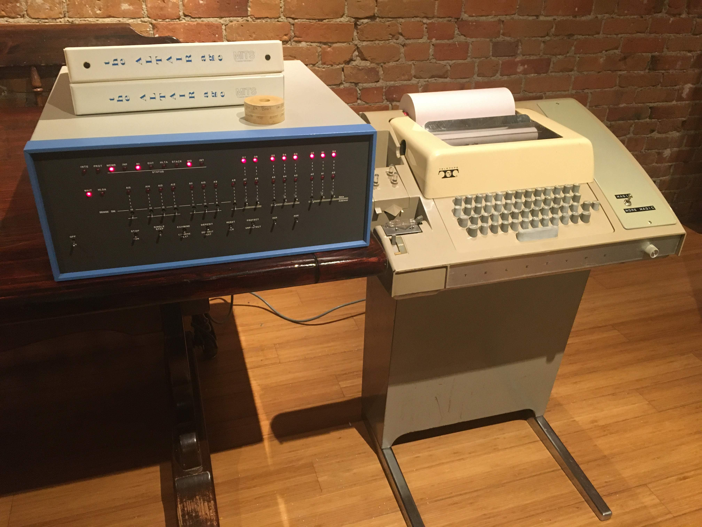
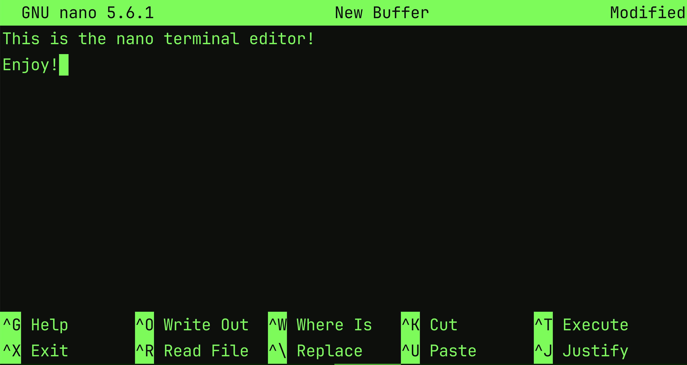

---
layout: two-cols
---

# Terminal, shell, command line, console...

- Terminal
  - A text input and output interface
  - Terminal emulator (GNOME Terminal, konsole, Terminal, iTerm2 etc. )
- Shell
  - A program that interprets commands
- Command line
  - Where you type a command in the shell
  - Indicated by a prompt (`$`, `%`, `>` etc.)
- Console
  - A text/graphical interface with display device

::right::

<div class="h-full flex flex-col justify-center gap-3">
<div class="w-3/5 self-center">

</div>
<div class="w-3/5 self-center">

</div>
</div>

---

# Why is it important to know the Bash shell?

- It allows you to capture your workflow in a reproducible manner (shell
  scripting)
- HPC systems commonly use shell commands and scripts
- There are different shells:
  - Bash, Zsh, fish, Ksh, Tcsh, Dash...
  - Bash is widely used on Linux
- It can be overwhelming at first to use a shell:
  - It assumes the user already knows what to type
  - It requires some time to get used to it

---
layout: two-cols
---

# Commands and arguments

::left::

The general form:

<div class="text-2xl text-center pt-2 pb-6">
Command + Arguments
</div>

- Commands
  - What the shell runs: a program or a shell builtin
- Arguments
  - Programs often take options so their behaviour can be customised
  - Inputs to the command, such as filenames

::right::

```console
$ ls
$ ls -F
$ ls -l -h /home/user/Downloads
$ ls -lh /home/user/Downloads

$ man ls
$ man man
$ git --help
$ git status --help

$ grep -i 'def' *.py
$ grep --ignore-case 'def' *.py
$ find . -type f -name '*.pdf' -print
$ tar xvzf something.tar.gz

$ make -j4
$ make -j 4
$ make --jobs 4
$ make --jobs=4
```

<div class="mb-2 border border-stone-500 rounded p-2 text-stone-700 text-xs">
You can press 'Ctrl-C' to abort a running command.
</div>

---
layout: two-cols
---

# List the contents of a directory

::left::

Use the program `ls` to check what is in a directory:

- `ls` lists the current directory
- `ls Downloads/` lists a specified directory
- `-l` shows details
- `-h` shows human-readable sizes with `-l`
- `-F` indicates types:
  - `/` for directories
  - `*` for executables
- `-a` includes names beginning with a dot (hidden entries)

::right::

```console
$ ls
big_dataset  data  file1.txt  file2.txt  file3.txt

$ ls -F
big_dataset  data/  file1.txt  file2.txt  file3.txt

$ ls -lha
total 24
drwxr-xr-x@ 8 user  group   256B  7 Aug 13:41 .
drwx------@ 3 user  group    96B  7 Aug 13:28 ..
-rw-r--r--@ 1 user  group    76B 20 Oct 17:41 .gitignore
-rw-r--r--@ 1 user  group   9.2G 25 Oct 09:19 big_dataset
drwxr-xr-x@ 2 user  group    64B 17 Sep 17:29 data
-rw-r--r--@ 1 user  group   721B 15 Oct 17:28 file1.txt
-rw-r--r--@ 1 user  group    18K 15 Oct 15:10 file2.txt
-rw-r--r--@ 1 user  group   1.7K 15 Oct 17:29 file3.txt
```

---

# File system

It is important to know where you are in the file system:

- `pwd`: print working directory
  - This will print the absolute path of your current directory
- Absolute path always starts with `/` (root)
  - E.g. `/home/user/Documents/papers`
- Relative path is relative to your current directory
  - E.g. `Documents/papers`

```console
$ pwd
/home/user
```

---
layout: two-cols
---

# Navigating the file system

::left::

Use `cd` to change directory:

- `cd Documents/` changes to a specified directory
  - `cd` goes to your home directory
  - `~` expands to your home directory
- `cd ..` goes to the parent directory
  - E.g. `/home/user/` is the parent directory of `/home/user/Documents/`
  - `.` indicates your current directory
- `cd -` changes to the previous directory

::right::

```console
$ pwd
/home/user
$ cd /tmp
$ pwd
/tmp
$ cd -
/home/user
$ cd Documents/
$ cd ..
$ pwd
/home/user
$ cd -
/home/user/Documents
$ cd
$ pwd
/home/user
```

---
layout: two-cols
---

# Creating files and directories

- `mkdir results` creates a directory
  - `mkdir -p results/day1/data` creates any missing intermediate directories
- `touch notes.txt` updates its timestamps
  - Creates an empty file if missing

::right::

```console
$ cd /tmp
$ mkdir data
$ pwd
/tmp
$ ls -F
data/
$ touch file1.txt
$ ls -F
data/  file1.txt
$ touch file2.txt file3.txt data/config.yaml
$ ls -F
data/  file1.txt  file2.txt  file3.txt
$ ls -F data/
config.yaml
$ mkdir -p data/2026-12-01/trial_1
$ ls data/2026-12-01/
trial_1
```

---
layout: two-cols
---

# Terminal editor

::left::

- Write scripts etc. as **plain text** using a text editor
- There are many text editors to choose from:
  - `nano`
  - `emacs`
  - `vim`
- If you are starting out, `nano` is a good choice

```bash
nano file1.txt
```

- Being able to proficiently edit a text file in a terminal will make your life
  much easier!

::right::

<div class="h-full flex flex-col items-center justify-center">

</div>

---
layout: two-cols
---

# Moving, renaming and copying

::left::

- `mv old.txt new.txt` renames a file
- `mv notes.txt results/` moves a file
- `cp notes.txt copy.txt` copies a file
- `cp -r results results_copy` copies a directory and its contents

<div class="mt-10 border border-stone-500 rounded p-2 text-stone-700">
Existing destination files will be overwritten.
</div>

::right::

```console
$ ls -F
data/  file1.txt  file2.txt  file3.txt
$ mv file1.txt file_1.txt
$ ls -F
data/  file_1.txt  file2.txt  file3.txt
$ mv file2.txt file3.txt data/
$ ls -F data/
file2.txt  file3.txt
$ cp file_1.txt file_1.txt.backup
$ ls -F
data/  file_1.txt  file_1.txt.backup
$ cp -r data/ data_backup/
$ ls -F data_backup/
file2.txt  file3.txt
$ mv data/file2.txt data/file3.txt    # !!!
$ ls data/
file3.txt
```

---
layout: two-cols
---

# Removing files and directories

::left::

- `rm notes.txt` removes a file
- `rmdir old_results` removes an empty directory
- `rm -r old_results` removes a directory and its contents

<div class="mt-10 border border-stone-500 rounded p-2 text-stone-700">
No recycling bin or any undo, once it is gone it is gone!
</div>

::right::

```console
$ ls -F
data/  file1.txt  file2.txt  file3.txt  plots/
$ rm file1.txt file2.txt
$ ls -F
data/  file3.txt  plots/
$ ls -F data/
config.yaml
$ rm data/
rm: cannot remove 'data/': Is a directory
$ rm -r data/
$ ls -F
file3.txt  plots/
$ ls plots/
$ rmdir plots/
$ ls -F
file3.txt
```

---
layout: two-cols
---

# Wildcards

::left::

Bash expands unquoted patterns into matching entries:

- `*`: zero or more characters
  - `sample_*.txt` matches both `sample_1.txt` and `sample_10.txt`
- `?`: exactly one character
  - `sample_?.txt` matches `sample_1.txt`, but not `sample_10.txt`

::right::

```console
$ ls -F
data/      file10.txt  file3.txt   LICENCE.md  README.md
file1.txt  file2.txt   file42.txt  logo.png
$ mv file?.txt data/
$ ls -F data/
file1.txt  file2.txt  file3.txt
$ rm *.md
$ ls -F
data/  file10.txt  file42.txt  logo.png
$ ls *.md
ls: cannot access '*.md': No such file or directory
$ rm '*.png'
rm: cannot access '*.png': No such file or directory
```

---
layout: two-cols
---

# Simple file inspection

::left::

- `cat notes.txt` prints the contents
- `wc notes.txt` counts number of lines, words and bytes
- `wc -l notes.txt` shows number of lines only
- `head notes.txt` and `tail notes.txt` display the first lines and last part
  of a file respectively
  - The default number of lines to display is 10
  - This can be controlled by the option `-n`

::right::

```console
$ ls
file1.txt  file2.txt
$ cat file1.txt
This is what is inside file1.txt!
I am just a humble text file.
$ wc file1.txt
     2     13     64 file1.txt
$ wc -l file1.txt
     2 file1.txt
$ ls -l file1.txt
-rw-r--r--@ 1 user  group  64 14 Jan 13:14 file1.txt
$ wc file2.txt
    15    30    180 file2.txt
$ head -n 4 file2.txt
t1   0.1294
t2   0.1399
t3   0.1394
t4   0.1192
$ tail -n 1 file2.txt
t15  0.1582
```

---
layout: two-cols
---

# Redirection

::left::

There are 3 standard streams (input/output connections):

- Standard input `stdin`
- Standard output `stdout`
- Standard error `stderr`

They are typically physical devices such as keyboards and monitors attached to
the terminal, but they can be **redirected** to/from files.

- `<` reads input from a file
- `>` creates or replaces an output file
- `>>` creates or appends to an output file

::right::

`cat file1.txt file2.txt > combined.txt` concatenates `file1.txt` and
`file2.txt` to create a new file `combined.txt`.

<br/>
<br/>
<br/>

`tr` reads from `stdin`. For example, 'translating' spaces to underscores:

```bash
tr ' ' '_' < names.txt
tr ' ' '_' < names.txt > clean_names.txt
tr ' ' '_' < other_names.txt >> clean_names.txt
```

`Grace Hopper` becomes `Grace_Hopper`.

---
layout: two-cols
---

# Pipeline

::left::

- The pipe `|` connects one command's `stdout` to the next command's `stdin`
- Combine small tools to perform a larger task: an important Unix philosophy

::right::

Count the bytes in the first 4 lines:

```console
$ head -n 4 file2.txt
t1   0.1294
t2   0.1399
t3   0.1394
t4   0.1192
$ head -n 4 file2.txt | wc -c
     48
```

<br/>

Capitalise the 't' in lines 3 and 4 and save it to a new file:

```console
$ head -n 4 file2.txt | tail -n 2 | tr 't' 'T' > t3_t4.txt
$ cat t3_t4.txt
T3   0.1394
T4   0.1192
```

---
layout: two-cols
---

# Shell script

::left::

- A shell script is a plain text file of reusable commands
- The first line, the **shebang**, selects the interpreter
  - `#!/bin/bash` uses Bash to interpret the commands
  - `#!/usr/bin/env bash` finds the path for you
  - Without the shebang, you can `bash my_script.sh` to run it with Bash
- HPC batch jobs commonly use shell scripts

::right::

- It is not necessary to save the script with the `.sh` extension but it is a
  common convention
- `chmod u+x` adds execute permission for the owner

Save as `clean_names.sh`:

```bash
#!/usr/bin/env bash
tr ' ' '_' < names.txt > clean_names.txt
cat clean_names.txt
```

Make it executable and run it:

```console
$ chmod u+x clean_names.sh
$ ls -l clean_names.sh
-rwxr--r--@ 1 user  group  81 30 Oct 16:43 clean_names.sh
$ ./clean_names.sh
Grace_Hopper
```

---
layout: two-cols
---

# Variables and arguments

::left::

- Variables can be assigned with `name=value`
  - No spaces around `=`
  - Can be referred to by prefixing with `$`
- `$1`, `$2`, etc. hold the script's arguments
  - `$0` holds the name of the script
- Use `echo` to print out the value of a variable
- Use `"$name"` to keep a value with spaces together
- `export` makes a variable available to subsequently launched programs:

```bash
export course_name='Bash introduction'
```

::right::

Change `clean_names.sh` to accept two filenames:

```bash
#!/usr/bin/env bash
input_file=$1
output_file=$2
echo "Input file is $input_file"
echo "Output file is $output_file"
# note the >>
tr ' ' '_' < "$input_file" >> "$output_file"
```

Now it can be used on different files:

```bash
./clean_names.sh names.txt clean_names.txt
./clean_names.sh other_names.txt clean_names.txt
```

---
layout: two-cols
---

# Loops

::left::

- `for`-loops allow repeated operations for each item from a list
- The loop body is enclosed by the keywords `do` and `done`

::right::

Count the lines in files with extensions `.md`:

```bash
for f in *.md
do
  echo "Number of lines for $f is:"
  wc -l "$f"
done
```

<br/>

Create several copies of the same file:

```bash
for i in {2..5}
do
  cp file1.txt file$i.txt
done
```

---

# This is just the beginning!

There is much more about the Bash shell:

- Tools:
  - `grep`: find lines matching patterns in files
  - `find`: find files matching patterns in a directory tree
  - `less`, `more`, `sed`, `awk`...
- Parameter expansion: `${output_path:-$TMPDIR}`...
- Command substitution: `make -j$(nproc)`...
- Process substitution: `diff file1.txt <(sort file2.txt)`
- `tmux`, a terminal multiplexer
  - Provides a convenient way to manage multiple terminal sessions
