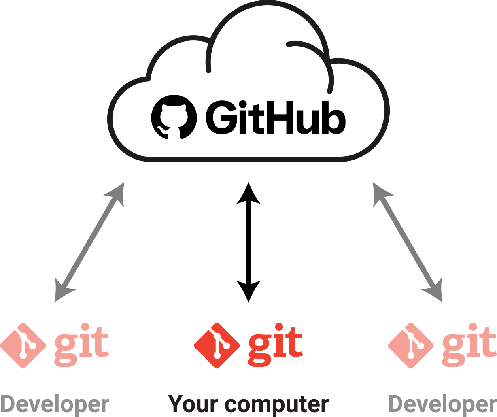
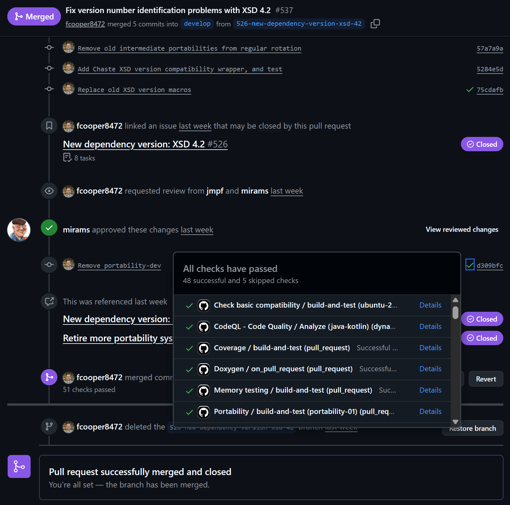
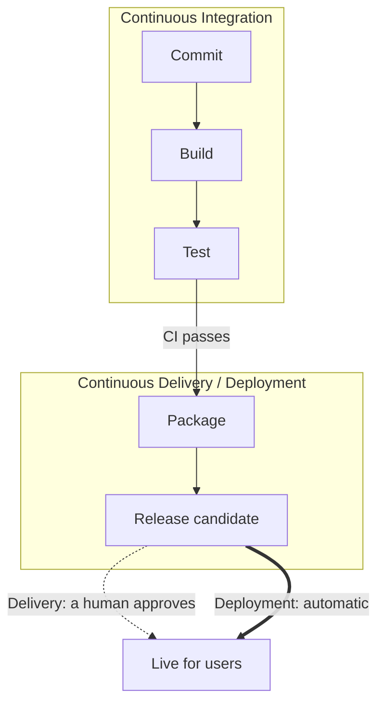
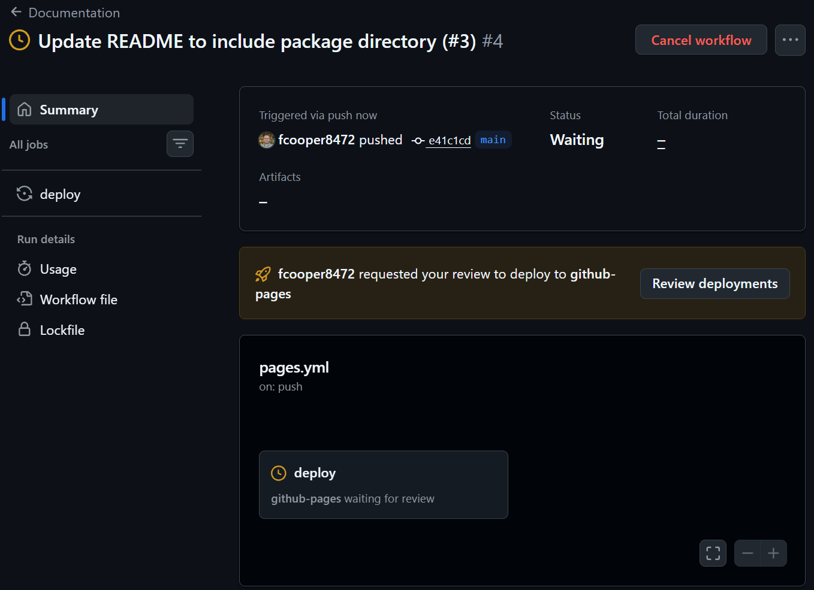
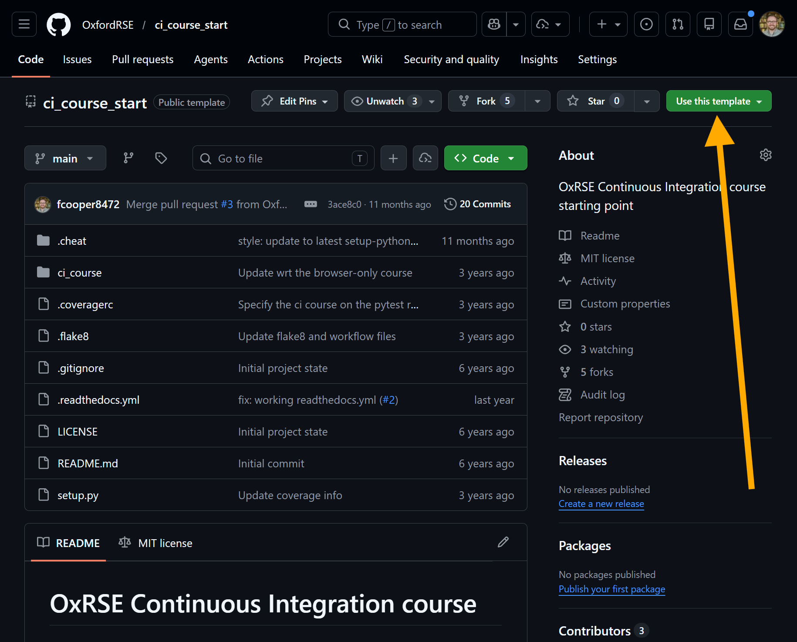

---
layout: default
---

# Introduction to Continuous Integration (CI)

<v-clicks>

- **Continuous Integration (CI)** is an automated process for verifying and integrating code changes
- Objective: detect and resolve issues early by frequently testing and integrating code changes
- Helps ensure **compatibility**, **functionality**, and reduces unexpected problems
- Once you trust the tests, **Continuous Delivery / Deployment (CD)** automates what happens next

</v-clicks>

<style>
    ul { @apply flex flex-col h-100 justify-evenly text-xl }
</style>

---
layout: two-cols
---

# Challenges without CI

<div class="text-base opacity-70 mb-3">Why not just run the tests yourself before you push?</div>

<v-clicks>

- **Compatibility**: ensuring code works across different operating systems, software versions, and hardware
- **Consistency**: avoiding hidden dependencies on user data or machine-specific configuration
- **Collaboration**: managing code changes from multiple developers without conflict

</v-clicks>

<style>
    ul { @apply flex flex-col h-90 justify-evenly text-xl }
</style>

::right::
<div class="pl-4 pt-8">
  <p class="mb-3 text-sm font-semibold tracking-wide text-gray-600">
    Same codebase, different outcomes across platforms
  </p>
  <table class="w-full text-base border-separate border-spacing-1">
    <thead>
      <tr class="text-white">
        <th class="bg-gray-500 p-2"></th>
        <th class="bg-gray-500 p-2 font-semibold">Ubuntu</th>
        <th class="bg-gray-500 p-2 font-semibold">Windows</th>
        <th class="bg-gray-500 p-2 font-semibold">MacOS</th>
      </tr>
    </thead>
    <tbody>
      <tr>
        <td class="bg-gray-200 p-2 text-left">Python 3.14</td>
        <td class="bg-gray-200 p-2 text-center text-green-500 text-2xl">&#10003;</td>
        <td class="bg-gray-200 p-2 text-center text-pink-500 text-2xl">&#10007;</td>
        <td class="bg-gray-200 p-2 text-center text-green-500 text-2xl">&#10003;</td>
      </tr>
      <tr>
        <td class="bg-gray-100 p-2 text-left">Python 3.13</td>
        <td class="bg-gray-100 p-2 text-center text-green-500 text-2xl">&#10003;</td>
        <td class="bg-gray-100 p-2 text-center text-green-500 text-2xl">&#10003;</td>
        <td class="bg-gray-100 p-2 text-center text-green-500 text-2xl">&#10003;</td>
      </tr>
      <tr>
        <td class="bg-gray-200 p-2 text-left">Python 3.12</td>
        <td class="bg-gray-200 p-2 text-center text-green-500 text-2xl">&#10003;</td>
        <td class="bg-gray-200 p-2 text-center text-green-500 text-2xl">&#10003;</td>
        <td class="bg-gray-200 p-2 text-center text-green-500 text-2xl">&#10003;</td>
      </tr>
      <tr>
        <td class="bg-gray-100 p-2 text-left">Python 3.11</td>
        <td class="bg-gray-100 p-2 text-center text-green-500 text-2xl">&#10003;</td>
        <td class="bg-gray-100 p-2 text-center text-green-500 text-2xl">&#10003;</td>
        <td class="bg-gray-100 p-2 text-center text-green-500 text-2xl">&#10003;</td>
      </tr>
    </tbody>
  </table>
</div>

---
layout: two-cols
---

# Key principles of CI

<div class="text-base opacity-70 mb-3">What a working pipeline assumes</div>

<v-clicks>

- **Single source repository**: code and dependencies in a shared repository
- **Automated builds**: compile, package, and create installers automatically
- **Self-testing builds**: automated tests run after each build to validate functionality
- **Fast builds**: quick feedback, or people stop waiting for it

</v-clicks>

<style>
    ul { @apply flex flex-col h-90 justify-evenly text-xl }
</style>

::right::
<div class="pl-4 flex items-center justify-center h-full">
  
</div>

---
layout: two-cols
---

# Key principles of CI (continued)

<div class="text-base opacity-70 mb-3">How a team works with it</div>

<v-clicks>

- **Frequent commits**: integrate changes regularly to avoid complex merge conflicts
- **Use an integration machine**: run builds and tests in a standardised, clean environment
- **Visibility and transparency**: make build and test results accessible to the whole team
- **Automated deployment**: releasing is a reproducible step, not a manual chore

</v-clicks>

<style>
    ul { @apply flex flex-col h-90 justify-evenly text-xl }
</style>

::right::

<div class="pl-4 flex items-center justify-center h-full">
  
</div>


---
layout: two-cols
---

# From integration to delivery

<div class="text-base opacity-70 mb-3">CI confirms that a change is suitable. What happens next?</div>

<v-clicks>

- **Continuous Delivery**: every change that passes is _prepared_ for release, a human still decides when
- **Continuous Deployment**: no approval step &mdash; passing changes go live automatically
- The pipeline is identical until the last step: the only difference is **whether a human approves**

</v-clicks>

<style>
    ul { @apply flex flex-col h-90 justify-evenly text-lg }
</style>

::right::

<div class="pl-4 flex items-center justify-center h-full">



</div>

---

# Continuous Integration and Delivery tools

<v-clicks>

<div class="flex items-center gap-4 py-2">
  
  <p class="m-0"><strong>GitHub Actions</strong>: CI/CD built into GitHub &mdash; what we will use today</p>
</div>

<div class="flex items-center gap-4 py-2">
  
  <p class="m-0"><strong>GitLab CI/CD</strong>: the equivalent where an institution hosts its own GitLab</p>
</div>

<div class="flex items-center gap-4 py-2">
  
  <p class="m-0"><strong>Jenkins</strong>: self-hosted and long-established, common in secure data environments</p>
</div>

<p class="pt-2 opacity-70">You will still see <strong>Travis CI</strong> and <strong>AppVeyor</strong> in older projects &mdash; both have largely been displaced</p>

<p class="pt-1">The YAML differs but the principles are the same &mdash; <strong>triggers</strong>, <strong>jobs</strong>, <strong>runners</strong> and <strong>steps</strong> exist in all of them</p>

</v-clicks>

<style>
    p { @apply text-xl }
</style>

---
layout: section
title: " "
---

## Setting it up

---
layout: two-cols
---

# Basic GitHub Actions

<div class="pr-4">

<ul class="space-y-3">
  <li v-click="1">Workflows are defined in YAML</li>
  <li v-click="2">
    Common triggers:
    <ul class="mt-2">
      <li><code>push</code></li>
      <li><code>pull_request</code></li>
      <li><code>workflow_dispatch</code></li>
    </ul>
  </li>
  <li v-click="3">Jobs run on specified runners such as <code>ubuntu-latest</code></li>
  <li v-click="4">Each job contains one or more <strong>steps</strong></li>
</ul>

</div>

::right::
<div class="pl-4 pt-6">

```yaml {1-13|1-13|3-6|8-10|11-13}
name: Hello World

on:
  push:
  pull_request:
  workflow_dispatch:

jobs:
  basic-job:
    runs-on: ubuntu-latest
    steps:
      - name: Run a one-line script
        run: echo "Hello, world!"
```

</div>

---
layout: two-cols
---

# Matrix builds

<div class="pr-4">

<ul class="space-y-3">
  <li v-click="1">One job, run many times over</li>
  <li v-click="2">Vary the <strong>Python version</strong>, the <strong>operating system</strong>, or both</li>
  <li v-click="3"><code>fail-fast: false</code> lets <em>all</em> jobs finish, so you see <em>everywhere</em> that it breaks</li>
  <li v-click="4">This is how you find out what doesn't work <em>on someone else's machine</em></li>
</ul>

</div>

::right::
<div class="pl-4 pt-6">

```yaml {all|all|2,5-7|4|all}
tests:
  runs-on: ${{ matrix.os }}
  strategy:
    fail-fast: false
    matrix:
      os: [ubuntu-latest, macos-latest, windows-latest]
      python-version: ["3.12", "3.13", "3.14"]
  steps:
    - uses: actions/checkout@v7
    - uses: actions/setup-python@v7
      with:
        python-version: ${{ matrix.python-version }}
```

</div>

<style>
    .slidev-layout pre.slidev-code,
    .slidev-layout pre.slidev-code code {
      font-size: 0.62rem !important;
      line-height: 1.45 !important;
    }
</style>

---
layout: two-cols
---

# A deployment workflow

<div class="pr-4">

<ul class="space-y-3">
  <li v-click="1">Same skeleton: <code>on</code>, <code>jobs</code>, <code>steps</code></li>
  <li v-click="2">Only merged code goes live &mdash; <code>branches: [main]</code></li>
  <li v-click="3">The job gets a <strong>scoped token</strong>, not blanket access</li>
  <li v-click="4"><code>run</code> is your own command; <code>uses</code> pulls in a prewritten action</li>
  <li v-click="5">No human gate here, so this is Continuous <strong>Deployment</strong></li>
</ul>

</div>

::right::
<div class="pl-4 pt-2">

```yaml {all|all|3-5|7-10|17-26|all}
name: Documentation

on:
  push:
    branches: [main]

permissions:
  contents: read
  pages: write
  id-token: write

jobs:
  deploy:
    runs-on: ubuntu-latest
    environment: github-pages
    steps:
      - uses: actions/checkout@v7
      - uses: actions/setup-python@v7
        with:
          python-version: "3.13"
      - run: pip install .[docs]
      - run: sphinx-build -W -b html docs docs/_build/html
      - uses: actions/configure-pages@v6
      - uses: actions/upload-pages-artifact@v5
        with: { path: docs/_build/html }
      - uses: actions/deploy-pages@v5
```

</div>

<style>
    .slidev-layout pre.slidev-code,
    .slidev-layout pre.slidev-code code {
      font-size: 0.6rem !important;
      line-height: 1.45 !important;
    }
</style>

---
layout: two-cols
---

# Making the checks count

<div class="pr-4">

<ul class="space-y-3">
  <li v-click="1">A red cross changes nothing on its own &mdash; the merge button still works</li>
  <li v-click="2"><strong>Before the commit</strong>: pre-commit hooks, instant but optional</li>
  <li v-click="3"><strong>Before the merge</strong>: required status checks, slower but binding</li>
  <li v-click="4">Writing the check is the easy part &mdash; a check nobody <em>has</em> to pass will eventually be ignored</li>
</ul>

</div>

::right::
<div class="pl-4 pt-6">
  <p class="mb-3 text-sm font-semibold tracking-wide text-gray-600">
    Three places, one set of checks
  </p>
  <table class="w-full text-sm border-separate border-spacing-1">
    <thead>
      <tr class="text-white">
        <th class="bg-gray-500 p-2 font-semibold text-left">Where</th>
        <th class="bg-gray-500 p-2 font-semibold text-left">Strength</th>
        <th class="bg-gray-500 p-2 font-semibold text-left">Weakness</th>
      </tr>
    </thead>
    <tbody>
      <tr v-click="2">
        <td class="bg-gray-200 p-2">Pre-commit hook</td>
        <td class="bg-gray-200 p-2">Immediate feedback</td>
        <td class="bg-gray-200 p-2">Optional, skippable</td>
      </tr>
      <tr v-click="1">
        <td class="bg-gray-100 p-2">Workflow run</td>
        <td class="bg-gray-100 p-2">Clean machine, every platform</td>
        <td class="bg-gray-100 p-2">Only reports</td>
      </tr>
      <tr v-click="3">
        <td class="bg-gray-200 p-2">Required status check</td>
        <td class="bg-gray-200 p-2">Actually binding</td>
        <td class="bg-gray-200 p-2">Has to be switched on</td>
      </tr>
    </tbody>
  </table>
</div>

---
layout: two-cols
---

# When it goes red

<div class="pr-4">

<ul class="space-y-3">
  <li v-click="1">The red step is where the run <strong>stopped</strong>, not always where it went wrong</li>
  <li v-click="2">Expand the steps that <em>passed</em> too</li>
  <li v-click="3"><strong>Re-run</strong> for a flaky network or runner &mdash; your own bugs fail the same way twice</li>
  <li v-click="4">Run the same commands <strong>locally</strong> first: CI is for what your machine <em>can't</em> tell you</li>
</ul>

</div>

::right::
<div class="pl-4 pt-6">

<div v-click="1">

```yaml
- run: pip install .[developer]   # passed
- run: ruff check .               # failed
```

```text
ruff: command not found
```

</div>

<div v-click="2" class="pt-2">

```text
WARNING: ci-course 0.1.0 does not provide
         the extra 'developer'
```

</div>

</div>

<style>
    .slidev-layout pre.slidev-code,
    .slidev-layout pre.slidev-code code {
      font-size: 0.66rem !important;
      line-height: 1.45 !important;
    }
</style>

---
layout: two-cols
---

# Keeping the build fast

<div class="pr-4">

<ul class="space-y-3">
  <li v-click="1">A slow pipeline changes what people do: they batch up changes, so changes get bigger</li>
  <li v-click="2"><strong>Cache</strong> what you download every time</li>
  <li v-click="3"><strong>Cancel</strong> runs nobody is waiting for &mdash; but never a half-finished deployment</li>
  <li v-click="4"><strong>Skip</strong> irrelevant changes &mdash; but a skipped required check blocks the merge</li>
</ul>

</div>

::right::
<div class="pl-4 pt-6">

<div v-click="2">

```yaml
- uses: actions/setup-python@v7
  with:
    cache: pip
    cache-dependency-path: pyproject.toml
```

</div>

<div v-click="3" class="pt-2">

```yaml
concurrency:
  group: ${{ github.workflow }}-${{ github.ref }}
  cancel-in-progress: true
```

</div>

<div v-click="4" class="pt-2">

```yaml
on:
  push:
    paths-ignore: ["**.md"]
```

</div>

</div>

<style>
    .slidev-layout pre.slidev-code,
    .slidev-layout pre.slidev-code code {
      font-size: 0.66rem !important;
      line-height: 1.45 !important;
    }
</style>

---
layout: two-cols
---

# Keeping what a run makes

<div class="pr-4">

<ul class="space-y-3">
  <li v-click="1">Every runner is destroyed when its job ends</li>
  <li v-click="2">An <strong>artifact</strong> is a set of files saved out of a run &mdash; not committed, deleted after a while</li>
  <li v-click="3">Build the docs on every pull request: reviewers see the result, not just a green tick</li>
</ul>

</div>

::right::
<div class="pl-4 pt-6">

```yaml {all|all|11-16|1-4}
name: Documentation preview

on:
  pull_request:

jobs:
  docs-preview:
    runs-on: ubuntu-latest
    steps:
      # ...check out, install, sphinx-build...
      - uses: actions/upload-artifact@v7
        with:
          name: documentation-preview
          path: docs/_build/html
          if-no-files-found: error
          retention-days: 7
```

</div>

<style>
    .slidev-layout pre.slidev-code,
    .slidev-layout pre.slidev-code code {
      font-size: 0.66rem !important;
      line-height: 1.45 !important;
    }
</style>

---
layout: two-cols
---

# Who decides it goes live?

<div class="pr-4">

<ul class="space-y-3">
  <li v-click="1"><code>needs:</code> makes one job wait for another: tests &rarr; build-docs &rarr; deploy</li>
  <li v-click="2">Build <strong>once</strong>, deploy the artifact that was built</li>
  <li v-click="3">An <code>environment:</code> can require a person to approve &mdash; Deployment becomes <strong>Delivery</strong></li>
  <li v-click="4">The approval lives in repository settings, not in the YAML</li>
</ul>

<div v-click="1" class="pt-4">

```yaml
deploy:
  needs: build-docs
  environment: github-pages
```

</div>

</div>

::right::
<div class="pl-4 flex items-center justify-center h-full">
  
</div>

<style>
    .slidev-layout pre.slidev-code,
    .slidev-layout pre.slidev-code code {
      font-size: 0.66rem !important;
      line-height: 1.45 !important;
    }
</style>

---
layout: two-cols
---

# Whose code are you running?

<div class="pr-4">

<ul class="space-y-3">
  <li v-click="1">Every <code>uses:</code> runs somebody else's code</li>
  <li v-click="2">A tag is a label, and labels can be moved</li>
  <li v-click="3">A full commit hash cannot</li>
  <li v-click="4">Give each job only the permissions it needs, and don't leave credentials lying around</li>
</ul>

</div>

::right::
<div class="pl-4 pt-6">

<div v-click="2">

```yaml
- uses: actions/checkout@v7
- uses: codecov/codecov-action@v7
```

</div>

<div v-click="3" class="pt-2 sha">

```yaml
# v7.1.1, by its full 40-character hash
- uses: codecov/codecov-action@303a32d7a59b442fa8d48b6a1cc6825c09c847a5
```

</div>

<div v-click="4" class="pt-2">

```yaml
permissions:
  contents: read
steps:
  - uses: actions/checkout@v7
    with:
      persist-credentials: false
```

</div>

</div>

<style>
    .slidev-layout pre.slidev-code,
    .slidev-layout pre.slidev-code code {
      font-size: 0.6rem !important;
      line-height: 1.45 !important;
    }
    .sha pre.slidev-code,
    .sha pre.slidev-code code {
      font-size: 0.5rem !important;
    }
</style>

---
layout: two-cols
---

# Keeping it honest

<div class="pr-4">

<ul class="space-y-3">
  <li v-click="1"><strong>zizmor</strong> audits your workflows the way ruff audits your Python</li>
  <li v-click="2">A policy: GitHub's own actions by tag, everything else by hash</li>
  <li v-click="3">A pin stops receiving fixes &mdash; <strong>Dependabot</strong> proposes updates as pull requests</li>
  <li v-click="4">A <code>cooldown</code> lets other people find the bad release first</li>
  <li v-click="5">Note: self-hosted runners on a public repository run strangers' pull requests on <em>your</em> hardware</li>
</ul>

</div>

::right::
<div class="pl-4 pt-6">

<div v-click="2">

```yaml
# zizmor.yml
rules:
  unpinned-uses:
    config:
      policies:
        actions/*: ref-pin
        "*": hash-pin
```

</div>

<div v-click="3" class="pt-2">

```yaml
# .github/dependabot.yml
version: 2
updates:
  - package-ecosystem: github-actions
    directory: "/"
    schedule: { interval: weekly }
    cooldown: { default-days: 14 }
    groups:
      actions: { patterns: ["*"] }
```

</div>

</div>

<style>
    .slidev-layout pre.slidev-code,
    .slidev-layout pre.slidev-code code {
      font-size: 0.62rem !important;
      line-height: 1.45 !important;
    }
</style>

---

# This course

### Hands-on setup of CI for a small **Python** project using **GitHub Actions**

<v-clicks>

1. **GitHub Actions**: matrices, linting, and "works on my machine"
2. **Code coverage** with pytest and Codecov
3. **Docstrings**: another kind of coverage
4. **Documentation** with Sphinx, deployed to GitHub Pages &mdash; your first **CD**
5. Checks **before you commit** and **before you merge**
6. **Debugging** failures and keeping the build **fast**
7. **Artifacts** and **approving** a deployment
8. **Supply chain**: trusting the code your workflows run

</v-clicks>

<p align="center" v-click class="color:gray; pt-4 opacity-70">Might be more than fits in one session </p>

<style>
    ol { @apply grid grid-flow-col grid-rows-4 gap-x-10 gap-y-4 pt-4 text-lg }
</style>

---
layout: two-cols
---

# Getting started with the course

<v-clicks>

- Visit the [**GitHub Template Repository**](https://github.com/OxfordRSE/ci_course_start)
- Click **Use this template** and create a new repository
- Name it anything you like, but make it **public** &mdash; free GitHub Pages and Codecov need it
- Clone it to your local machine
- Follow the course at [**train.rse.ox.ac.uk**](https://train.rse.ox.ac.uk/material/HPCu/software_project_management/continuous_integration)

</v-clicks>

<style>
    ul { @apply flex flex-col h-100 justify-evenly text-xl }
</style>

::right::

<div class="h-full flex items-center justify-right">
  
</div>
