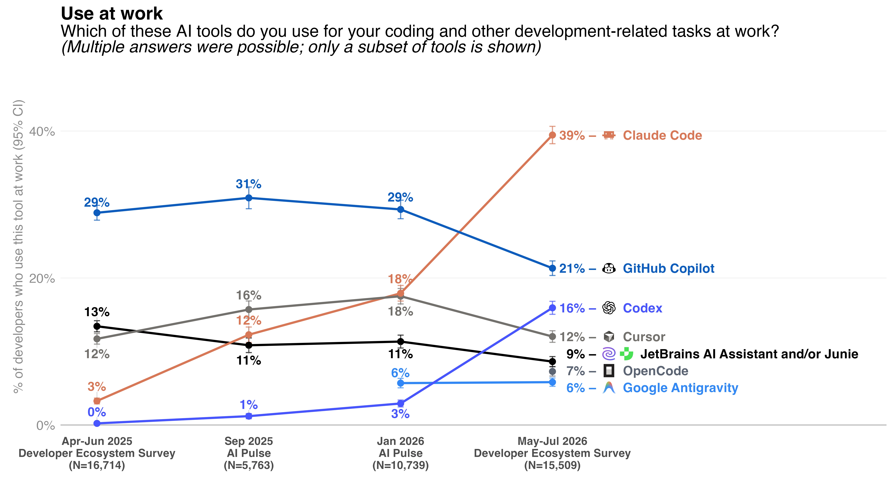
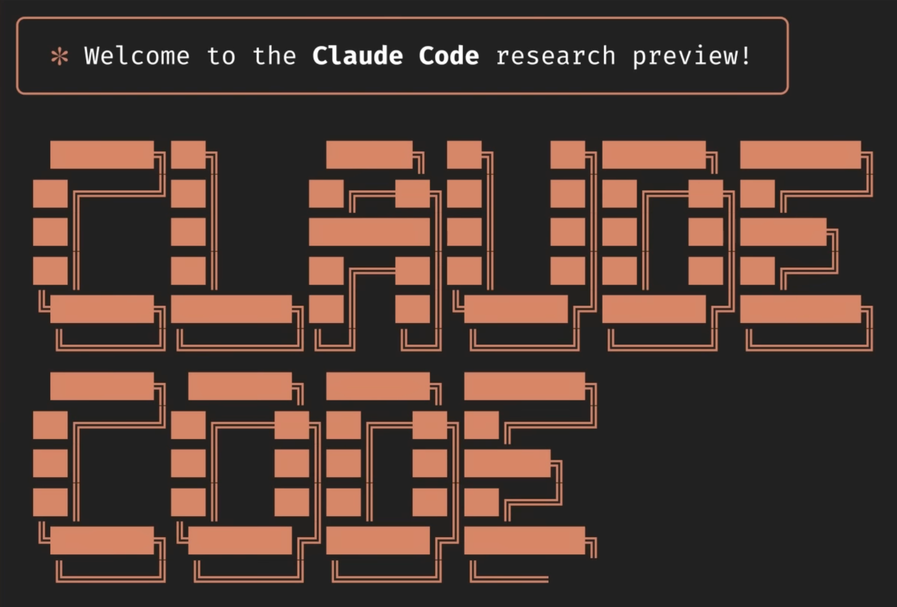
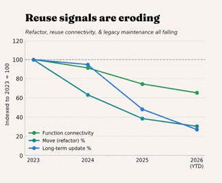
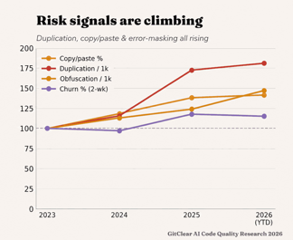
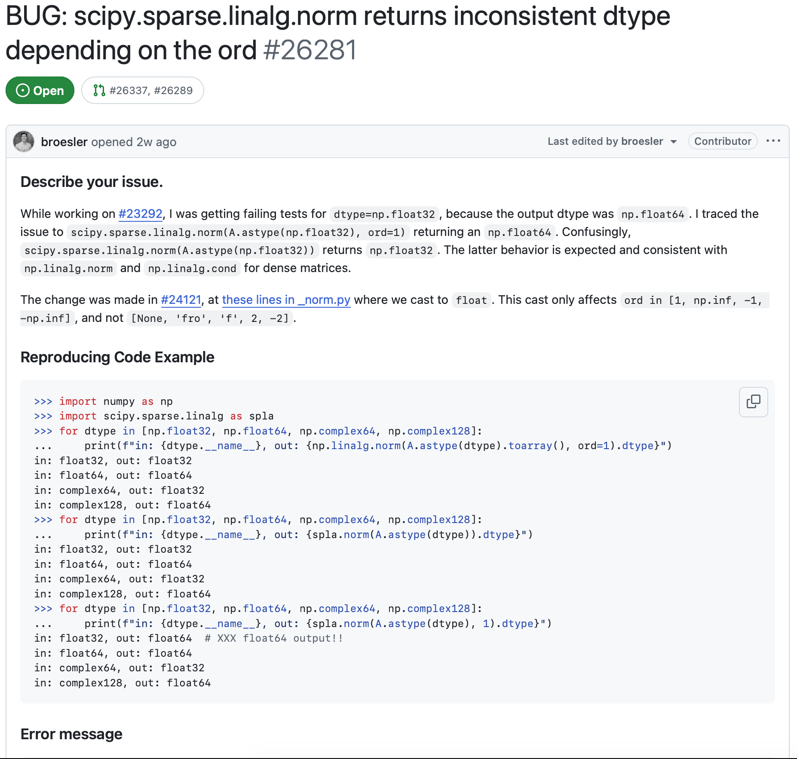
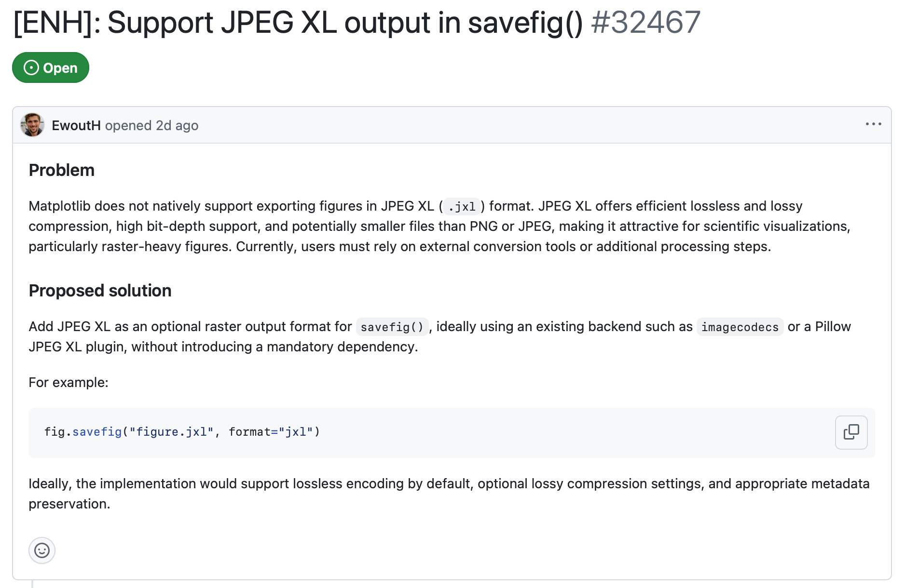
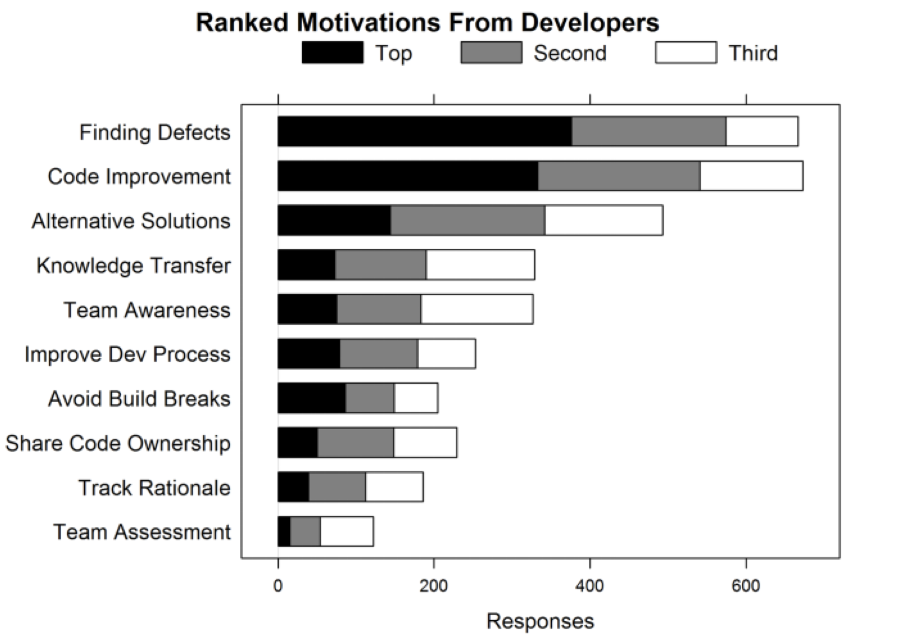
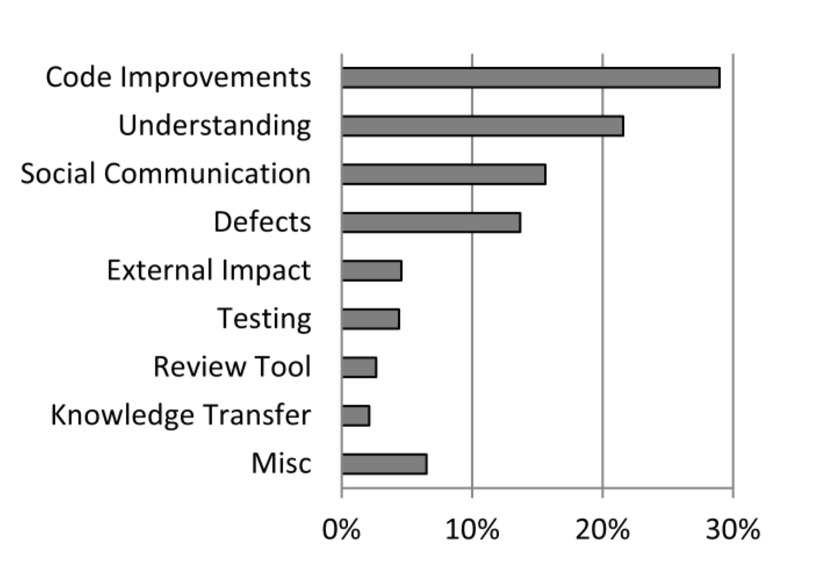
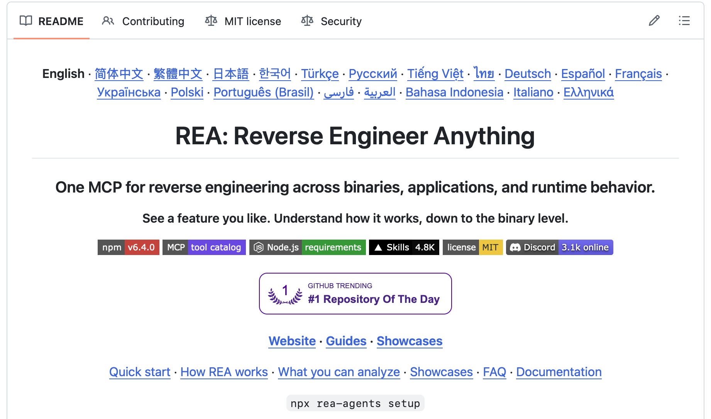

---

```yaml
layout: orientation
title: Orientation
highlight: Directing Coding Agents
training-event-only: true
```

---
layout: two-cols-header
---

# What is a coding agent

::left::

<div class="pt-4">

> A coding agent is a piece of software that acts as a **harness** for an LLM,
> extending that LLM with additional capabilities that are powered by invisible
> prompts and implemented as callable tools.

</div>

<div class="text-sm text-right pt-2">Simon Willison, <a href="https://simonwillison.net/guides/agentic-engineering-patterns/how-coding-agents-work/">"How coding agents work"</a></div>

<div class="text-2xl font-bold text-center pt-20">agent = model + harness</div>

::right::

<div class="pl-4 pt-4">

- **Model**: the underlying LLM
- **Harness**: everything around the model,
  - **loop**: run a tool, feed the result back, and repeat
  - **tools**: read and edit files, inspect commit history, run your tests
    etc.
  - **context management**: compact, handle caches
  - **guardrails**: what it can and cannot do

</div>

::bottom::

<div class="text-sm opacity-60">
Harness components after Anthropic, <a href="https://claude.com/blog/harnessing-claudes-intelligence">"Agent harness design"</a>, 2 April 2026.
</div>

---
layout: two-cols-header
---

# Before coding agents

::left::

Trend: desire to work with computers with higher level of abstraction

Assembler, compiler etc.

::right::

Grace Hopper compiler photos

---
layout: two-cols-header
---

# Automatic programming

Quote wiki definition.

Some examples

Note compiler etc. is deterministic but not LLM-powered coding agents

---
layout: two-cols-header
---

# Modern coding agents

::left::

<div class="pr-4 h-full flex flex-col justify-between">

- **Copilot** (2021): inline suggestions
- **Aider** (2023), **Cursor** (2024): instruction files, slash commands
- **Claude Code** (2025): subagents, hooks, skills
- Later coding agents such as **Codex**, **OpenCode**, **Copilot**,
  **Antigravity** etc. are heavily influenced by Claude Code.

<div class="text-sm opacity-60">
JetBrains, <a href="https://blog.jetbrains.com/research/2026/08/ai-coding-agent-adoption-2026/">AI coding agent adoption</a>, August 2026 (15,509 developers surveyed May-July 2026).
</div>

</div>

::right::

<div class="pl-4 h-full flex flex-col justify-center gap-3">

<div class="w-3/5 self-center">

</div>
</div>

---

# Interfaces for coding agents

- Web
  - can be connected to your GitHub account

Able to access files and tools locally:

- Extension/plugins in editors
  - VS Code plugins
  - Co-pilot
- Desktop apps
  - ChatGPT Desktop, Claude Desktop
- Terminal
  - Claude Code, Codex CLI, OpenCode

---
layout: two-cols-header
---

::left::

# Characteristics of agents' generated code

<div class="h-full flex flex-col justify-between">

<v-clicks>

- The difficulty is in its throughput
- Often very verbose
  - High coupling
  - Convoluted code path
- Common anti-patterns to watch out for:
  - ignore what is available and implement its own solution
  - employ shortcuts (reward hacking)
    - amend tests
    - adjust tolerance
  - not aware of latest features/deprecations

</v-clicks>

<div class="text-sm opacity-60">
GitClear, <a href="https://www.gitclear.com/the_ai_code_quality_maintainability_gap">The Maintainability Gap: AI Code Quality in 2026</a>, July 2026.
</div>

</div>

::right::

<div class="h-full flex flex-col justify-center gap-3">
<div class="w-3/5 self-center">

</div>
<div class="w-3/5 self-center">

</div>
</div>

---
layout: two-cols-header
---

# Before prompting coding agents (Explore-Plan)

::left::

**Explore**

- Is this actually a bug?
- Is this the expected behaviour?
- What does `ord=1` mean?
  - Why did some `ord` work?
- Why did it get cast to `float` in the stated change?

<div class="mt-6 border border-stone-500 rounded p-2 text-stone-700">
The purpose is to gather enough information to guide what should be done.
</div>

::right::
<div class="h-full flex flex-col justify-center">

<div class="text-xs text-center opacity-60">
<a href="https://github.com/scipy/scipy/issues/26281">SciPy issue 26281</a>
</div>
</div>

---
layout: two-cols-header
---

# Before prompting coding agents (Explore-Plan)

::left::

**Plan**

- How should I fix it?
  - Should I remove the cast?
  - Handle it as a special case?
- How do I know it is fixed?
  - What tests should I have?
- How would the fix impact:
  - users currently depend on the function
  - internal functions that use this function

<div class="mt-6 border border-stone-500 rounded p-2 text-stone-700">
The purpose is to decide what should be done and revise the details.
</div>

::right::
<div class="h-full flex flex-col justify-center">

<div class="text-xs text-center opacity-60">
<a href="https://github.com/scipy/scipy/issues/26281">SciPy issue 26281</a>
</div>
</div>

---
layout: two-cols-header
---

# Before prompting coding agents (Explore-Plan)

::left::

**Explore**

- What is the motivation for this feature?
  - Are the claimed benefits real?
  - How big difference is it for 'scientific visualisation'?
  - Is this a common format?
  - If we implement this, why not the others?
- Are the proposed backends:
  - really an existing dependencies?
  - able to support JPEG XL? which one is better?

<div class="mt-2 border border-stone-500 rounded p-2 text-stone-700">
The purpose is to collect enough evidence that this is worth implemented.
</div>

::right::
<div class="h-full flex flex-col justify-center">

<div class="text-xs text-center opacity-60">
<a href="https://github.com/matplotlib/matplotlib/issues/32467">Matplotlib issue 32467</a>
</div>
</div>

---
layout: two-cols-header
---

# Before prompting coding agents (Explore-Plan)

::left::

**Plan**

- How should the feature be implemented?
  - 'Lossless by default', is this a good choice? Trade-off?
  - Is `savefig` the only API affected?
  - How should we deal with errors during conversion?
- How should we verify the feature is successfully implemented?

<div class="mt-6 border border-stone-500 rounded p-2 text-stone-700">
The purpose is to decide what should be done and revise the details.
</div>

::right::
<div class="h-full flex flex-col justify-center">

<div class="text-xs text-center opacity-60">
<a href="https://github.com/matplotlib/matplotlib/issues/32467">Matplotlib issue 32467</a>
</div>
</div>

---
layout: two-cols-header
---

# The purpose of code review (Code-Commit)

::left::

<div class="h-full flex flex-col justify-between">

So perhaps, we can use a coding agent to review coding agent's generated code
(`/code-review`)!

But code review is never just about catching bugs:

> discipline of explaining your code to your peers \[that\] drives a higher
> standard of coding. I think the process is even more important than the result.

<!-- for passing markdownlint -->

> one of the things that should be happening with code reviews over time is a
> distribution of knowledge. If you do a code review and did not learn anything
> about the area and you still do not know anything about the area, then that
> was not as good code review as it could have been.

</div>

::right::

<div class="h-full flex flex-col justify-center">



<div class="pb-5 text-sm opacity-60">
A. Bacchelli and C. Bird, "Expectations, outcomes, and challenges of modern
code review," ICSE, 2013, pp. 712-721, doi: <a
href="https://ieeexplore.ieee.org/document/6606617">10.1109/ICSE.2013.6606617</a>
</div>

</div>
---
layout: two-cols-header
---

# Can coding agents help with reviewing code?

::left::


Coding agents can help with:

<v-clicks>

- flagging high-risk changes
- catching known security issues
- stress-testing assumptions
- checking compliance
- identifying dead codes

</v-clicks>

::right::

<v-clicks>

Remember:

- Human retains the ownership and every decision
- Coding agents should never (and can't!) take final accountability
- Think twice before letting coding agents to auto-merge or auto-commit changes

</v-clicks>

---
layout: two-cols-header
---

# Human attention is precious

::left::

Know what deserves your valuable human attention:

- architecture design
- core logics
- implementation choice
- human-readable documentation
- understanding (cognitive and intent debt)

<div class="mt-4">

> I've seen quite a few code reviews where someone commented
> on formatting while missing the fact that there were security
> issues or data model issues.

</div>

::right::

<div class="h-full flex flex-col justify-center">



<div class="pb-5 text-sm opacity-60">
<div class="text-center">(Types of comments in code review)</div>

A. Bacchelli and C. Bird, "Expectations, outcomes, and challenges of modern
code review," ICSE, 2013, pp. 712-721, doi: <a
href="https://ieeexplore.ieee.org/document/6606617">10.1109/ICSE.2013.6606617</a>
</div>

</div>
---

# Working with agents' generated code

<v-clicks>

- Um, can we solve a problem without any code?
  - Codes can be easily generated but doesn't mean we should
- Distinguish a plausible solution with ones that really address the issues
- Know when is 'good enough'
- Independent verification:
  - reference implementation
  - specification
  - formal verification

</v-clicks>

<div v-click class="mt-6 border border-teal-500 rounded p-2 text-sm text-teal-700">

A simple question to ask yourself: 'can I really explain what have changed and why?'

</div>

---

# About usage limit

This is all about how you manage the context window in a session, some tips:

<v-clicks>

- Decompose a task into smaller pieces
- Aggressively `/clear` to reset the context window
- Consider `/compact` for long conversation
  - More efficient when the cached prompt still hot
- Keep a 'journal' as a persistent artefact that can be passed to another fresh session
  - Modern coding agents implement this as 'memory'
- Employ subagents for isolated tasks, e.g.:
  - Explore a particular topic
  - Make sense of an error message
  - Looking for typos

</v-clicks>

---

# About usage limit (con't)

<v-clicks>

- Use `/side`/`/btw` for query unrelated to the main task
- Use a hierarchical `AGENTS.md`/`CLAUDE.md`
- Use more LLM-friendly format whenever possible:
  - Plain text/HTML instead of PDF
  - Extract data points yourself for a plot instead of PNG/JPEG
- Use appropriate model for your task
  - Adjust the thinking level by `/effort`
- Plan your day
  - Start a session, e.g. 5 a.m. (automate this for your wellbeing)
  - If you start working at 9 a.m., your usage limit will be reset at 10 a.m.
    (assume a 5-hour reset)

</v-clicks>

---
layout: two-cols-header
---

# Cautions

::left::

<v-clicks>

- Implement whatever possible without careful consideration
- Permission
  - Think twice before using `--dangerously-skip-permissions` etc. flags
- Burn out
  - Fatigue of monitoring agents generated codes
  - Babysit coding agents 24/7
  - `/remote-control` could be intrusive to your life

</v-clicks>

::right::

<div class="h-full flex flex-col justify-center">

</div>

---

# Obstacles to using coding agents

- It does not do what you intended.
- It goes further than you asked.
- It claims everything works but it doesn't!
- It produces more code than you can meaningfully read and review.
- It deviates from its initial goal.

<div class="pt-10 grid grid-cols-[auto_320px_auto] justify-start gap-x-3 gap-y-1 items-center text-sm">
  <div>Violates an explicit developer constraint</div>
  <div><div class="h-3 rounded-sm" style="width: 38.3%; background: var(--oxrse-bg-colour)"></div></div>
  <div class="opacity-60 text-right">38.3%</div>
  <div>Acts on a wrong interpretation of what was requested</div>
  <div><div class="h-3 rounded-sm" style="width: 27.0%; background: var(--oxrse-bg-colour)"></div></div>
  <div class="opacity-60 text-right">27.0%</div>
  <div>Misreports the status (e.g. success) of its own work</div>
  <div><div class="h-3 rounded-sm" style="width: 22.6%; background: var(--oxrse-bg-colour)"></div></div>
  <div class="opacity-60 text-right">22.6%</div>
  <div>Produces code that is logically or syntactically incorrect</div>
  <div><div class="h-3 rounded-sm" style="width: 17.8%; background: var(--oxrse-bg-colour)"></div></div>
  <div class="opacity-60 text-right">17.8%</div>
  <div>Misreads the codebase, system state or technical behaviour</div>
  <div><div class="h-3 rounded-sm" style="width: 11.6%; background: var(--oxrse-bg-colour)"></div></div>
  <div class="opacity-60 text-right">11.6%</div>
  <div>Takes actions beyond the stated scope</div>
  <div><div class="h-3 rounded-sm" style="width: 10.2%; background: var(--oxrse-bg-colour)"></div></div>
  <div class="opacity-60 text-right">10.2%</div>
  <div>Commands or tool calls are operationally malformed</div>
  <div><div class="h-3 rounded-sm" style="width: 2.9%; background: var(--oxrse-bg-colour)"></div></div>
  <div class="opacity-60 text-right">2.9%</div>
</div>

<div class="text-sm opacity-60 pt-3">
N. Tang et al., "How coding agents fail their users", <a href="https://arxiv.org/abs/2605.29442">arXiv:2605.29442</a> (2026), <a href="https://arxiv.org/html/2605.29442v2#S4.T3">Table 3</a>.
</div>

---

# Learning objectives

The practical session has four modules:

1. Know how to prompt an agent the context, the boundaries and the success
   conditions it needs.
2. Judge whether a bug report is written well enough for an agent to act on at
   all.
3. Decide whether a feature should exist at all, then say what must exist, what
   must not change, and what counts as done.
4. Familiarise yourself with code you did not write.

<div class="mt-10 border border-stone-500 rounded p-2 text-stone-700">
You will look at some issues from real-world codebases, but the purpose of the
practical session is not to teach you how to contribute to those codebases by
using coding agents (read their AI policy).
</div>

---

```yaml
layout: questions
training-event-only: true
```

---

```yaml
src: ../../epilogue/main.md
training-event-only: true
```
