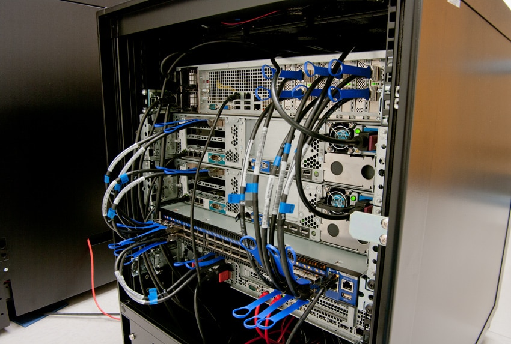
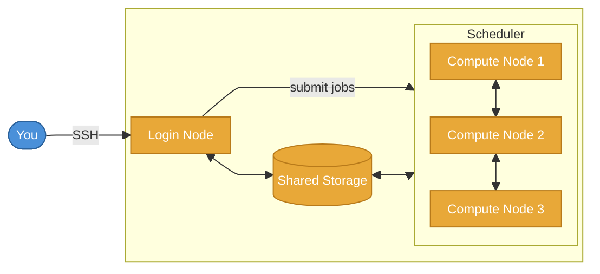
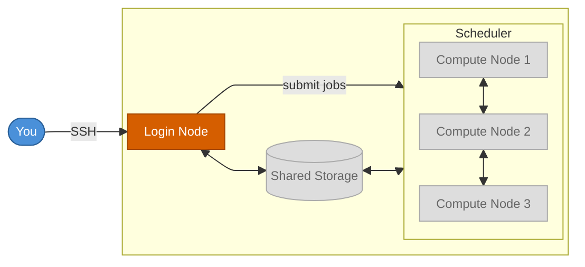
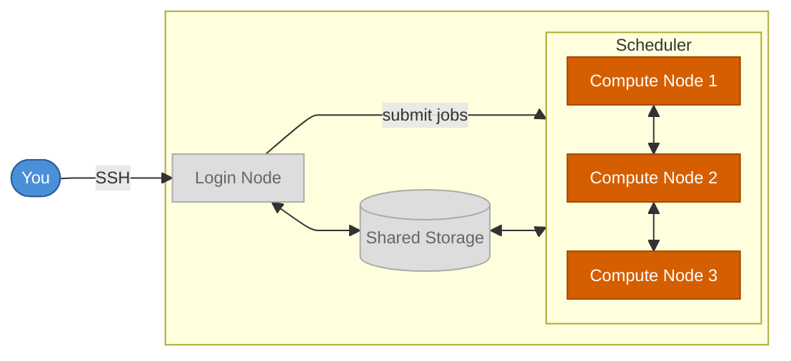
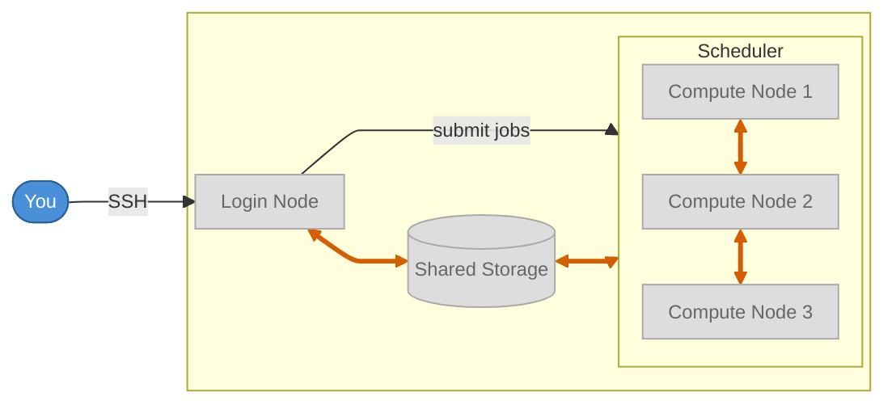
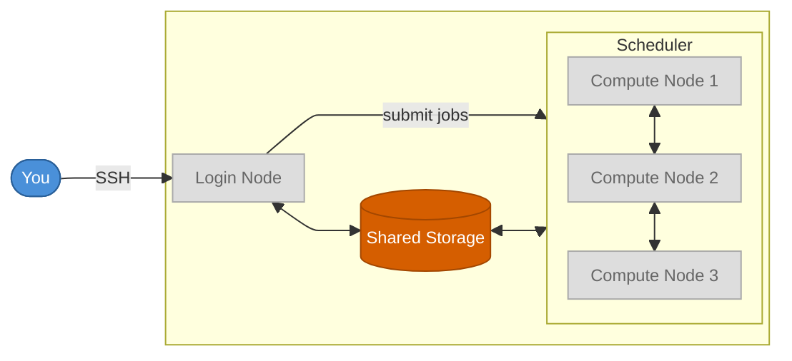
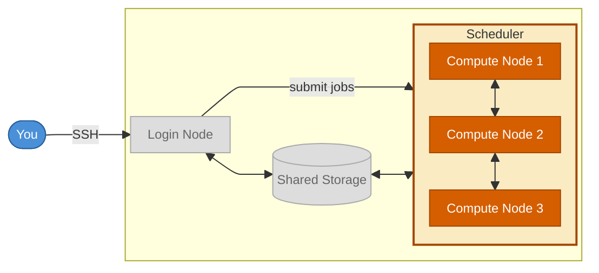

---
layout: two-cols
---

# What is HPC?

<div v-click>

**High-Performance Computing**

</div>

<div v-click>

Using many computers together to solve problems too large or slow for a single machine.

</div>

<div v-click>

**High-Throughput Computing**

Running many independent jobs, such as one analysis over thousands of inputs.

</div>

::right::
<div class="h-full w-full flex items-center justify-center pl-4">
  
</div>

---
layout: two-cols
---

# What is a cluster?

<div v-click>

A collection of computers (nodes) connected by a network, working as one system.

</div>

<v-clicks>

- Each node has its own processors and memory
- A network connects everything together
- Nodes share a common storage system
- A scheduler coordinates which jobs to run and where they run

</v-clicks>

::right::
<div v-click="1" class="h-full flex items-center justify-center pl-6">
<div class="cluster" :class="'step-' + $clicks">
  <div class="flex gap-6">
    <div class="stack"><div class="box sched">Scheduler</div><div class="wire"></div></div>
    <div class="stack"><div class="box storage">Shared storage</div><div class="wire"></div></div>
  </div>
  <div class="box net w-full">Network</div>
  <div class="flex gap-3 w-full">
    <div v-for="n in 3" :key="n" class="stack flex-1">
      <div class="wire"></div>
      <div class="node">
        <div class="node-label">Node {{ n }}</div>
        <div class="flex gap-1"><div class="box cpu flex-1">CPU</div><div class="box cpu flex-1">CPU</div></div>
        <div class="box mem">Memory</div>
      </div>
    </div>
  </div>
</div>
</div>

<style scoped>
.cluster {
  display: flex;
  flex-direction: column;
  align-items: center;
  width: max-content;
  font-size: 0.875rem;
  line-height: 1.2;
}
.cluster .stack { display: flex; flex-direction: column; align-items: center; }
.cluster .wire { width: 2px; height: 1rem; background: #666; }
.cluster .box {
  padding: 0.45rem 0.55rem;
  border: 1px solid #b87a1a;
  border-radius: 4px;
  background: #e8a838;
  color: #fff;
  text-align: center;
  transition: background 0.2s, border-color 0.2s, color 0.2s;
}
.cluster .node {
  display: flex;
  flex-direction: column;
  gap: 0.25rem;
  width: 100%;
  padding: 0.4rem;
  border: 1px solid #999;
  border-radius: 4px;
  background: #f5f5f5;
}
.cluster .node-label { color: #333; text-align: center; font-size: 0.85em; }
/* Clicks 2-5 dim everything, then highlight what the current bullet names. */
.cluster:is(.step-2, .step-3, .step-4, .step-5) .box { background: #ddd; border-color: #aaa; color: #666; }
.cluster.step-2 :is(.cpu, .mem),
.cluster.step-3 .net,
.cluster.step-4 .storage,
.cluster.step-5 .sched { background: #d55e00; border-color: #a34700; color: #fff; }
.cluster.step-3 .wire { background: #d55e00; }
</style>

---
layout: two-cols
---

# What makes it high-performance?

<v-clicks>

- Not just faster individual processors - **many processors working in parallel**
- High-speed interconnects (e.g. InfiniBand) between nodes
- Large amount of memory (terabytes across the cluster)
- Parallel file systems for fast I/O (NFS, GPFS, Lustre)

</v-clicks>

::right::
<div class="h-full w-full flex items-center justify-center pl-4">
  
</div>

---

# Why will I need it?

<v-clicks>

- Computation too slow on a local workstation (from days to hours)
- Dataset too large to fit in memory
- Need to run many independent tasks
- Examples:
  - ML model training
  - climate simulations
  - cosmological simulations
  - molecular dynamics
  - parameter sweeps

</v-clicks>

---

# Components of an HPC system

<div class="relative">
<div :class="{ invisible: $clicks > 0 }">

- **Login nodes**: access point, file management, job submission
- **Compute nodes**: where jobs run (CPUs, GPUs, memory)
- **Network**: high-speed interconnects between nodes and file systems
- **Storage**: shared file systems ($HOME, $DATA)
- **Scheduler**: allocates resources and manages job queue

</div>
<div class="absolute inset-0">
<v-switch at="1">
<template #1>

**Login nodes**: your way into the cluster

- Where you land when you connect over SSH
- For editing files, building code and submitting jobs
- Shared by all users, so no heavy computation

</template>
<template #2>

**Compute nodes**: where your jobs run

- Many CPU cores and lots of memory per node
- Reached through the scheduler, not directly
- Homogeneous (identical nodes) or heterogeneous (a mix, e.g. some with GPUs)

</template>
<template #3>

**Network**: links everything together

- High-speed interconnect (e.g. InfiniBand) between compute nodes
- Lets a single job span many nodes
- Also connects every node to the storage

</template>
<template #4>

**Storage**: shared file systems

- Visible from every node, so all your jobs see the same files
- Home: small, for code and configuration
- Data and scratch: large, for project data and job files

</template>
<template #5>

**Scheduler**: decides what runs where and when

- You request resources: cores, memory and time
- Jobs wait in a queue until those resources are free
- Shares the cluster fairly between users

</template>
</v-switch>
</div>
</div>

<v-switch at="1">
<template #0>



</template>
<template #1>



</template>
<template #2>



</template>
<template #3>



</template>
<template #4>



</template>
<template #5>



</template>
</v-switch>

---

# Connect to an HPC system

SSH to a login node:

```shell
ssh username@hpc.to.connect
```

Login nodes are **shared** by everyone on the cluster:

- Every user connects through the same few machines
- A heavy task there slows things down for everyone else
- They are for editing files, building code and submitting jobs

Login node etiquette: **no heavy computation**

---

# Load software with modules

Clusters keep many versions of software installed side by side. The **module** system chooses which ones you use.

See what is installed with `module avail`:

```shell
module avail            # list all available software
module avail Python     # list only the versions of Python
```

Load what you need:

```shell
module load Python/3    # load a specific package
```

Check what you have loaded with `module list`:

```shell
module list             # show loaded modules
```

---

# Use your own software

For software that is not in the module system, set up your own Python **virtual environment**:

```shell
module load Python/3            # start from a module's Python
python -m venv myenv            # create the environment
source myenv/bin/activate       # activate it (also in your job scripts)
pip install numpy               # install what you need
```

Or run a container with **Apptainer**:

```shell
apptainer exec my_container.sif echo "hello"
apptainer run docker://alpine echo "hello"
```

---

# The Scheduler

Manages fair access and priority to **shared** compute resources

You request resources -> scheduler queues your job -> runs it when resources are free

Slurm: one of the most popular scheduler for HPC system

<div class="sched">
<table>
  <thead><tr><th>Command</th><th>Purpose</th></tr></thead>
  <tbody>
    <tr v-click="1"><td><code>sbatch</code></td><td>Submit a job script</td></tr>
    <tr v-click="2"><td><code>squeue</code></td><td>Check job status</td></tr>
    <tr v-click="3"><td><code>scancel</code></td><td>Cancel a job</td></tr>
    <tr v-click="4"><td><code>sacct</code></td><td>Check job accounting data</td></tr>
    <tr v-click="5"><td><code>sinfo</code></td><td>View cluster status</td></tr>
    <tr v-click="6"><td><code>seff</code></td><td>Check job efficiency</td></tr>
  </tbody>
</table>
<div class="sched-out">
<v-switch at="1">
<template #1>

```console
$ sbatch myscript.sh
Submitted batch job 11018752
```

</template>
<template #2>

```console
$ squeue --me
   JOBID PARTITION   NAME     USER ST  TIME NODES NODELIST(REASON)
11018752     short my_job dtce0101  R  0:42     1 arc-c046
11018753     short my_job dtce0101 PD  0:00     1 (Priority)
```

</template>
<template #3>

```console
$ scancel 11018753
$ squeue --me
   JOBID PARTITION   NAME     USER ST  TIME NODES NODELIST(REASON)
11018752     short my_job dtce0101  R  1:05     1 arc-c046
```

</template>
<template #4>

```console
$ sacct -j 11018752 --format=JobID,JobName,State,Elapsed,MaxRSS
       JobID    JobName      State    Elapsed     MaxRSS
------------ ---------- ---------- ---------- ----------
11018752         my_job  COMPLETED   00:12:31
11018752.ba+      batch  COMPLETED   00:12:31      9872K
11018752.ex+     extern  COMPLETED   00:12:31          0
11018752.0       python  COMPLETED   00:12:24   1523400K
```

</template>
<template #5>

```console
$ sinfo
PARTITION   AVAIL  TIMELIMIT  NODES  STATE NODELIST
short          up   12:00:00    103    mix arc-c[046-052,...]
short          up   12:00:00    162  alloc arc-c[053,058-062,...]
short          up   12:00:00      1   idle arc-c221
...
devel          up      10:00      2   idle arc-c[294-295]
interactive    up    4:00:00      1    mix arc-c296
interactive    up    4:00:00      1   idle arc-c297
```

</template>
<template #6>

```console
$ seff 11018752
Job ID: 11018752
Cluster: arc
User/Group: dtce0101/internal
State: COMPLETED (exit code 0)
Nodes: 1
Cores per node: 4
CPU Utilized: 00:46:12
CPU Efficiency: 92.28% of 00:50:04 core-walltime
Job Wall-clock time: 00:12:31
Memory Utilized: 1.45 GB
Memory Efficiency: 36.25% of 4.00 GB
```

</template>
</v-switch>
</div>
</div>

<style>
.sched { display: grid; grid-template-columns: auto minmax(0, 1fr); gap: 1.25rem; align-items: start; }
.sched table { width: auto; margin: 0; }
.sched th, .sched td { padding: 0.25em 0.75em; white-space: nowrap; text-align: left; }
/* Rows not yet clicked in should leave no trace, borders included. */
.sched tr.slidev-vclick-hidden { border-color: transparent; }
/* Tie the row just revealed to the output shown beside it. */
.sched tr.slidev-vclick-current { background: #e8a83833; }
.sched-out { --slidev-code-font-size: 12px; --slidev-code-line-height: 1.4; }
.sched-out pre { margin: 0; }
</style>

---

# Submit an HPC job

The workflow:

<v-clicks>

1. Write a job script (bash + `#SBATCH` directives)
2. Submit with `sbatch myscript.sh`
3. Monitor with `squeue --me` (shortcut of `squeue -u $USER`)
4. Check log/output files
5. Check efficiency with `seff <JOBID>`, especially for the first few runs.

</v-clicks>

---

# An example submission script

```bash {*}{lines:true}
#!/bin/bash
#SBATCH --job-name=my_job         # name shown in squeue
#SBATCH --partition=short         # partition submitted to
#SBATCH --nodes=1                 # number of nodes
#SBATCH --ntasks=1                # number of tasks
#SBATCH --cpus-per-task=4         # number of CPUs
#SBATCH --time=01:00:00           # maximum walltime (HH:MM:SS)
#SBATCH --output=result_%j.out    # output file (%j = job ID placeholder)

module load Python/3
python --version

srun python my_job.py
```

<v-clicks>

`srun` creates a **job step** and if the above job requests `--ntasks=4`:

- `srun echo 'hello'` will print 'hello' 4 times
- `srun -n 2 echo 'hello'` will print 'hello' 2 times

</v-clicks>

---

# How much resources should I request?

Three key resources: **CPUs**, **memory**, **walltime**

<v-clicks>

- **Under-request**: job killed before completion
- **Over-request**: longer queue wait, wasted allocation
- Start with a small test run and **make sure it runs without error first**
- Observe the scaling of resource usage with your dataset size/number of iterations etc.
- Use `seff` to refine

  ```shell
  $ seff 11018740
  Job ID: 11018740
  Cluster: arc
  User/Group: dtce0101/internal
  State: TIMEOUT (exit code 0)
  Nodes: 4
  Cores per node: 45
  CPU Utilized: 355-13:57:16
  CPU Efficiency: 98.76% of 360-01:00:00 core-walltime
  Job Wall-clock time: 2-00:00:20
  Memory Utilized: 166.98 GB (estimated maximum)
  Memory Efficiency: 52.18% of 320.00 GB (80.00 GB/node)
  ```

</v-clicks>

---

# ARC at Oxford

- University of Oxford central HPC facility
- Clusters: **arc** and **htc**
  - CPU and GPU nodes (on _htc_)
- Scheduler: Slurm
- Login:

  ```shell
  ssh -Y username@arc-login.arc.ox.ac.uk # for arc cluster
  ssh -Y username@htc-login.arc.ox.ac.uk # for htc cluster
  ```

  - Graphical SSH clients: PuTTY, MobaXterm
  - Use SSH keys for security (private/public key pair)

---

# Storage Options in ARC

HPC systems provide multiple storage areas with different purposes:

| Storage     | Path                         | Use                    | Notes                  |
|-------------|------------------------------|------------------------|------------------------|
| **Home**    | `/home/username`             | Personal files         | 15 GiB quota           |
| **Data**    | `/data/projectname/username` | Shared project storage | 5 TiB quota            |
| **Scratch** | `$SCRATCH`                   | Temporary job files    | Deleted on job exit    |
| **Tmpdir**  | `$TMPDIR`                    | Local node storage     | Deleted on job exit    |

---
layout: iframe-right
url: https://arc-user-guide.readthedocs.io/en/latest/
---

# ARC user guide

Docs: <https://arc-user-guide.readthedocs.io/en/latest/>

---

# Conclusion

<v-clicks>

- HPC: many computers working together on your problem
- Access via SSH, manage software with modules or Apptainer
- Submit jobs through the scheduler (Slurm)
- Start small, then scale
- Consult the HPC documentation and support team

</v-clicks>

---
layout: two-cols
---

# Fun Fact
The MareNostrum supercomputer in Barcelona is housed in a neo-Gothic chapel.
It was featured in Dan Brown's _Origin_ (2017).

::right::
<div class="h-full w-full flex items-center justify-center">
  
</div>
