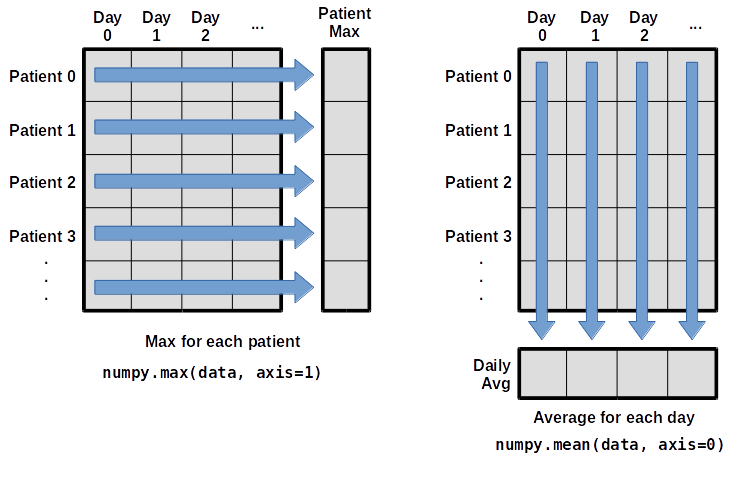
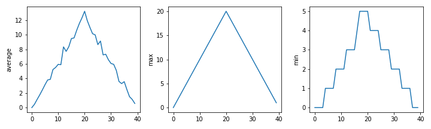

---

# Overview

1. Getting started: running Python, variables and types
2. Libraries and data: NumPy, Matplotlib and Pandas
3. Control flow: lists, loops and conditionals
4. When things go wrong: errors, functions and scope

<div class="pt-8">

- Everything here is in the **Intro to Python** course on train.rse
  - Full notes, exercises and solutions
  - Example data: download `uniqplus_python_data.zip` from the course
- These slides are the map, not the territory

</div>

---
layout: two-cols
---

# Why Python?

- **Readable**: the syntax is close to pseudocode
- **Interpreted**: no compile step, just run it
- **Dynamically typed**: no need to declare types
- **Multi-paradigm**: procedural, object-oriented, functional
- **Huge ecosystem**: NumPy, Pandas, Matplotlib, PyTorch, ...
- Probably what your supervisor/collaborators already use

::right::

<div class="pt-12">

```console
$ python -c "import this"
The Zen of Python, by Tim Peters

Beautiful is better than ugly.
Explicit is better than implicit.
Simple is better than complex.
...
Readability counts.
...
```

<span class="font-semibold text-lg text-red-700">Code is read far more often than it is written.</span>

</div>

---
layout: section
title: " "
---

## Part 1: Getting started

---
layout: two-cols
---

# Running Python

::left::

- Type `python` (or `python3`) in a terminal
- You get the **REPL**: Read-Eval-Print-Loop
  - Reads a command, evaluates it, prints the result, loops
  - Very quick feedback: great for trying things out
- `>>>` is the prompt, `...` is a continuation line
- `quit()` (or Ctrl-D) to leave

<div class="mt-10 border border-stone-500 rounded p-2 text-stone-700">
Don't worry about the details yet, it will all make sense by the end.
</div>

::right::

<div class="code-sm">

```python
>>> 1 + 6
7
>>> a = 2
>>> b = 3
>>> a + b
5
>>> word = "Hello"
>>> len(word)
5
>>> for word in ["Leeds", "Munich", "Marseille"]:
...     print("City name has", len(word), "letters in it.")
...
City name has 5 letters in it.
City name has 6 letters in it.
City name has 9 letters in it.
>>> quit()
```

</div>

---
layout: two-cols
---

# Writing scripts in an IDE

::left::

- The REPL forgets everything when you quit
- A **script** is a plain text file of Python code, saved as `.py`
- Write it in an IDE (Integrated Development Environment):
  - [VS Code](https://code.visualstudio.com/): what we'll use
  - [PyCharm](https://www.jetbrains.com/pycharm/) (Community Edition is free)
  - [Spyder](https://www.spyder-ide.org/): MATLAB-like
- You get syntax highlighting, autocomplete, a debugger, linting...
- Jupyter notebooks are also an option
  - Great for exploring, harder to reuse

::right::

Save as `hello.py`:

```python
name = "world"
print("Hello", name)
```

Run it from the terminal:

```console
$ python hello.py
Hello world
```

<div class="mt-10 border border-stone-500 rounded p-2 text-stone-700">
Or press the ▷ button in VS Code, which does the same thing.
</div>

---
layout: two-cols
---

# Variables

::left::

- `name = value` assigns a value to a variable
- `print` displays values
- Variables must be **created before they are used**
- Variables only change when you **assign** to them
- Python is **case-sensitive**: `age` and `Age` are different
- Use **meaningful names**
  - `flabadab = 42` works, `age = 42` is better

::right::

```python
>>> age = 42
>>> first_name = "Ahmed"
>>> print(first_name, "is", age, "years old")
Ahmed is 42 years old

>>> print(last_name)
NameError: name 'last_name' is not defined

>>> age = age + 3
>>> print("Age in three years:", age)
Age in three years: 45

>>> first = 1
>>> second = 5 * first
>>> first = 2
>>> print(second)   # still 5!
5
```

---
layout: two-cols
---

# Every value has a type

::left::

- `int`: whole numbers, e.g. `42`
- `float`: real numbers, e.g. `3.14`
- `str`: text, e.g. `"Hello"`
- `bool`: `True` or `False`
- `type()` tells you what you've got
- The type controls which operations make sense
  - `+` adds numbers, but joins strings
- Convert with `int()`, `float()`, `str()`
- You can mix `int` and `float` freely

::right::

```python
>>> type(52)
<class 'int'>
>>> type("some text")
<class 'str'>

>>> "Ada" + " " + "Lovelace"
'Ada Lovelace'
>>> "=" * 10
'=========='

>>> 1 + "2"
TypeError: unsupported operand type(s)
for +: 'int' and 'str'
>>> 1 + int("2")
3
>>> str(1) + "2"
'12'

>>> 1 + 2.5
3.5
```

---
layout: two-cols
---

# Indexing and slicing strings

::left::

- Use an index in `[]` to get a single character
- Python counts from **zero**
- A slice `[start:stop]` gets a substring
  - Includes `start`, but **stops before** `stop`
  - `stop - start` is the length
- Negative indices count from the end
- `len()` gives the length


::right::

```python
>>> atom_name = "sodium"
>>> atom_name[0]
's'
>>> atom_name[2]
'd'
>>> atom_name[-1]
'm'
>>> atom_name[0:3]
'sod'
>>> atom_name[3:]
'ium'
>>> len(atom_name)
6
>>> atom_name[6]
IndexError: string index out of range
```

<div class="mt-6 border border-stone-500 rounded p-2 text-stone-700">
Zero-indexing trips everyone up at first (especially MATLAB and R users).
</div>

---
layout: two-cols
---

# Built-in functions and help

::left::

- A function takes **arguments** and may **return** a value
  - `max(1, 2, 3)`, `round(3.712, 1)`, `len("abc")`
- Some arguments have **default values**
- **Methods** are functions attached to a value
  - `"hello".upper()`
- `#` starts a comment: ignored by Python, read by humans
- `help(round)` shows the documentation
- [docs.python.org](https://docs.python.org/3/) is your friend

::right::

```python
>>> max(1, 2, 3)
3
>>> min("a", "A", "0")
'0'
>>> round(3.712)
4
>>> round(3.712, 1)   # ndigits defaults to 0
3.7

>>> my_string = "Hello world!"
>>> my_string.upper()
'HELLO WORLD!'
>>> my_string.isupper()
False

>>> help(round)
Help on built-in function round in module builtins:

round(number, ndigits=None)
    Round a number to a given precision in decimal digits.
    ...
```

---
layout: section
title: " "
---

## Part 2: Libraries and data

---
layout: two-cols
---

# Libraries

::left::

- Most of the power of a language lies in its **libraries**
- A library (or package) is a collection of **modules**
- The **standard library** comes with Python: `math`, `glob`, `os`, `csv`...
- Many more on [PyPI](https://pypi.org/), installed with `pip`
- Why use them?
  - Someone has already solved your problem
  - Usually documented, tested and optimised
  - **Better than your code** (probably)

::right::

```python
>>> import math
>>> math.pi
3.141592653589793
>>> math.cos(math.pi)
-1.0

>>> from math import cos, pi
>>> cos(pi)
-1.0

>>> import math as m
>>> m.cos(m.pi)
-1.0

>>> help(math)
```

<div class="mt-6 border border-stone-500 rounded p-2 text-stone-700">
<code>numpy as np</code>, <code>pandas as pd</code> and <code>matplotlib.pyplot as plt</code> are conventions everyone uses.
</div>

---
layout: two-cols
---

# Loading data with NumPy

::left::

- NumPy: **Num**erical **Py**thon
  - Use it whenever you have lots of numbers, especially arrays
- The course uses the Carpentries **inflammation** data
  - 60 patients (rows) × 40 days (columns)
- `numpy.loadtxt` reads a CSV into an **array**
- Dot notation: `numpy.loadtxt` is the `loadtxt` that belongs to `numpy`
- Every element of an array has the **same type**

::right::

```python
>>> import numpy
>>> data = numpy.loadtxt(
...     fname="inflammation-01.csv",
...     delimiter=",",
... )
>>> data
array([[0., 0., 1., ..., 3., 0., 0.],
       [0., 1., 2., ..., 1., 0., 1.],
       ...,
       [0., 0., 1., ..., 1., 1., 0.]])

>>> type(data)
<class 'numpy.ndarray'>
>>> data.dtype
dtype('float64')
>>> data.shape
(60, 40)
```

---
layout: two-cols
---

# Slicing and analysing arrays

::left::

- Index with `[row, column]`, starting from zero
- Slice each dimension: `data[0:4, 0:10]`
- `numpy.mean`, `numpy.max`, `numpy.min`, `numpy.std`...
- `axis=` picks the direction
  - `axis=0`: down the rows, giving one value per **day**
  - `axis=1`: across the columns, giving one value per **patient**



::right::

```python
>>> data[0, 0]
0.0
>>> data[30, 20]
13.0
>>> data[0:4, 0:10]
array([[0., 0., 1., 3., 1., 2., 4., 7., 8., 3.],
       [0., 1., 2., 1., 2., 1., 3., 2., 2., 6.],
       [0., 1., 1., 3., 3., 2., 6., 2., 5., 9.],
       [0., 0., 2., 0., 4., 2., 2., 1., 6., 7.]])

>>> numpy.mean(data)
6.14875
>>> numpy.max(data, axis=1).shape
(60,)
>>> numpy.mean(data, axis=0).shape
(40,)
```

---
layout: two-cols
---

# Visualising with Matplotlib

::left::

> The purpose of computing is insight, not numbers.
>
> Richard Hamming

- `matplotlib` is the _de facto_ standard for plotting
- `imshow` for heatmaps, `plot` for lines
- Subplots put several plots in one figure
- Plotting is how you spot that **something is wrong**
  - The max rises and falls _too_ smoothly, and the min is a step function
  - Suspicious...

```python
import matplotlib.pyplot as plt
plt.imshow(data)
plt.show()
```

::right::

<div class="h-full flex flex-col justify-center gap-3">

</div>

---
layout: two-cols
---

# Pandas DataFrames

::left::

- Pandas: the library for **tabular** data
  - Borrows a lot from R's data frames
- A **DataFrame** is a 2D table with named columns
  - Columns can have different types
- `pd.read_csv` loads a CSV
  - `index_col` uses a column as row labels
- `.info()`, `.columns`, `.T` and `.describe()` to get a feel for the data
- The course uses the **Gapminder** GDP data

::right::

```python
>>> import pandas as pd
>>> data = pd.read_csv(
...     "data/gapminder_gdp_oceania.csv",
...     index_col="country",
... )
>>> data.info()
<class 'pandas.core.frame.DataFrame'>
Index: 2 entries, Australia to New Zealand
Data columns (total 12 columns):
 #   Column          Non-Null Count  Dtype
---  ------          --------------  -----
 0   gdpPercap_1952  2 non-null      float64
 ...

>>> data.describe()
       gdpPercap_1952  gdpPercap_1957  ...
count        2.000000        2.000000  ...
mean     10298.085650    11598.522455  ...
...
```

---
layout: two-cols
---

# Selecting data

::left::

- `.iloc[row, col]`: select by **position**
- `.loc[row, col]`: select by **label**
- `:` on its own means all rows or all columns
- Slices with `.loc` **include** the end label (unlike everything else!)
- Comparisons give a **Boolean mask**
  - Use the mask to select the values you want

::right::

<div class="code-sm">

```python
>>> data = pd.read_csv(
...     "data/gapminder_gdp_europe.csv",
...     index_col="country",
... )

>>> data.iloc[0, 0]
1601.056136
>>> data.loc["Albania", "gdpPercap_1952"]
1601.056136

>>> data.loc["Italy":"Poland", "gdpPercap_1962":"gdpPercap_1972"]
             gdpPercap_1962  gdpPercap_1967  gdpPercap_1972
country
Italy           8243.582340    10022.401310    12269.273780
Montenegro      4649.593785     5907.850937     7778.414017
Netherlands    12790.849560    15363.251360    18794.745670
Norway         13450.401510    16361.876470    18965.055510
Poland          5338.752143     6557.152776     8006.506993

>>> data[data > 10000]   # NaN where False
```

</div>

---
layout: two-cols
---

# Group by: split-apply-combine

::left::

- A very common analysis pattern:
  1. **Split** the data into groups
  2. **Apply** a function to each group
  3. **Combine** the results
- Example from the course: a "wealth score"
  - How often is a country above the European average GDP?
  - Group countries by score and sum each group
- Pandas does whole-column operations for you
  - No loops needed

::right::

```python
>>> mask_higher = data > data.mean()
>>> wealth_score = (
...     mask_higher.aggregate("sum", axis=1)
...     / len(data.columns)
... )
>>> wealth_score
country
Albania                   0.000000
Austria                   1.000000
...
United Kingdom            1.000000
dtype: float64

>>> data.groupby(wealth_score).sum()
          gdpPercap_1952  gdpPercap_1957  ...
0.000000    36916.854200    46110.918793  ...
0.333333    16790.046878    20942.456800  ...
0.500000    11807.544405    14505.000150  ...
1.000000   104317.277560   127332.008735  ...
```

---
layout: section
title: " "
---

## Part 3: Control flow

---
layout: two-cols
---

# Lists

::left::

- A list stores many values in **one** variable
  - `[value1, value2, ...]`
- Indexing and slicing work just like strings
- Lists are **mutable**: you can change them in place
  - `append`, `extend`, `del`, `pop`
- Strings are **immutable**: you can't
- Lists can hold anything, including other lists

::right::

```python
>>> pressures = [0.273, 0.275, 0.277, 0.275, 0.276]
>>> pressures[0]
0.273
>>> len(pressures)
5

>>> pressures[0] = 0.265
>>> pressures.append(0.280)
>>> del pressures[1]
>>> pressures
[0.265, 0.277, 0.275, 0.276, 0.28]

>>> element = "carbon"
>>> element[0] = "C"
TypeError: 'str' object does not support item assignment

>>> nested = [["pepper", "paprika"], ["salt"]]
>>> nested[0][1]
'paprika'
```

---
layout: two-cols
---

# For loops

::left::

- Run the same code **once for each value** in a collection
- Made up of:
  - a **collection**: `[2, 3, 5]`
  - a **loop variable**: `number`
  - a **body**: the indented code
- The first line **must end with a colon**
- The body **must be indented**
  - Indentation _is_ the syntax in Python
- `range(n)` gives the numbers `0` to `n - 1`

::right::

```python
for number in [2, 3, 5]:
    print(number)
```

```text
2
3
5
```

```python
for i in range(3):
    print(i, "squared is", i * i)
```

```text
0 squared is 0
1 squared is 1
2 squared is 4
```

```python
for number in [2, 3, 5]:
print(number)
```

```text
IndentationError: expected an indented block
```

---
layout: two-cols
---

# The accumulator pattern

::left::

- A very common loop: turn many values into **one**
  1. Initialise an accumulator **before** the loop
  2. Update it **inside** the loop
  3. Use it **after** the loop
- Works for sums, counts, building up lists or strings...

<div class="pt-6">
<span class="font-semibold text-lg text-red-700">You will write this loop thousands of times.</span>
</div>

::right::

Sum the first 10 integers:

```python
total = 0
for number in range(10):
    total = total + (number + 1)
print(total)
```

```text
55
```

<br/>

Build a list of word lengths:

```python
lengths = []
for word in ["red", "green", "blue"]:
    lengths.append(len(word))
print(lengths)
```

```text
[3, 5, 4]
```

---
layout: two-cols
---

# Conditionals

::left::

- `if` runs a block only when a condition is `True`
- `elif` adds more tests, `else` catches the rest
- Conditions are tested **once, in order**
  - The first `True` branch wins, the rest are skipped
- Comparisons: `==`, `!=`, `<`, `<=`, `>`, `>=`
- Combine with `and`, `or` and `not`
  - Use parentheses when mixing them
- Same colon and indentation rules as loops

::right::

```python
masses = [3.54, 2.07, 9.22, 1.86, 1.71]
for m in masses:
    if m > 9.0:
        print(m, "is HUGE")
    elif m > 3.0:
        print(m, "is large")
    else:
        print(m, "is small")
```

```text
3.54 is large
2.07 is small
9.22 is HUGE
1.86 is small
1.71 is small
```

```python
grade = 85
if grade >= 70:
    print("grade is C")
elif grade >= 80:
    print("grade is B")   # never reached!
```

---
layout: two-cols
---

# Looping over data sets

::left::

- Real analyses rarely use one file
- `glob.glob` finds files that match a pattern
  - The same `*` and `?` wildcards as Bash
- Combine `glob` with a `for` loop to process a batch of files
- This works best when files are **named consistently**
- Use `pathlib` for building file paths that work on any OS

::right::

```python
import glob
import pandas as pd

print(glob.glob("data/*.csv"))
```

```text
['data/gapminder_all.csv', ...]
```

```python
for filename in glob.glob("data/gapminder_*.csv"):
    data = pd.read_csv(filename)
    print(filename, data["gdpPercap_1952"].min())
```

```text
data/gapminder_all.csv 298.8462121
data/gapminder_gdp_africa.csv 298.8462121
data/gapminder_gdp_americas.csv 1397.717137
data/gapminder_gdp_asia.csv 331.0
data/gapminder_gdp_europe.csv 973.5331948
data/gapminder_gdp_oceania.csv 10039.59564
```

---
layout: section
title: " "
---

## Part 4: When things go wrong

---
layout: two-cols
---

# Reading a traceback

::left::

- Errors come with a **traceback**
- They look scary, but they are trying to help!
- Read them **from the bottom up**:
  1. The **error type** and message
  2. The line where it happened
  3. The calls that got you there
- Copy the last line into a search engine (or an LLM)
  - Someone has had this error before

::right::

```python
def favourite_ice_cream():
    ice_creams = [
        "chocolate",
        "vanilla",
        "strawberry",
    ]
    print(ice_creams[3])

favourite_ice_cream()
```

```text
Traceback (most recent call last):
  File "ice_cream.py", line 9, in <module>
    favourite_ice_cream()
  File "ice_cream.py", line 7, in favourite_ice_cream
    print(ice_creams[3])
          ~~~~~~~~~~^^^
IndexError: list index out of range
```

---
layout: two-cols
---

# Common errors

::left::

- `SyntaxError`: Python can't parse your code
  - Missing colons, brackets or quotes
- `IndentationError`: inconsistent indentation
  - Don't mix tabs and spaces
- `NameError`: a variable that doesn't exist (yet)
  - Usually a typo or a missing assignment
- `IndexError`: off the end of a list
- `FileNotFoundError`: wrong path or wrong directory
- `TypeError`: wrong type for the operation

::right::

```python
>>> def some_function()
SyntaxError: expected ':'

>>> print(a_variable)
NameError: name 'a_variable' is not defined

>>> letters = ["a", "b", "c"]
>>> letters[4]
IndexError: list index out of range

>>> open("myfile.txt", "r")
FileNotFoundError: [Errno 2] No such file or directory:
'myfile.txt'
```

<div class="mt-6 border border-stone-500 rounded p-2 text-stone-700">
Recent Python versions have much friendlier error messages. Another reason not to use Python 2!
</div>

---
layout: two-cols
---

# Writing functions

::left::

- Break programs down into functions
  - Easier to understand, test and reuse
  - Human working memory is small
- `def name(parameters):` followed by an indented body
- Defining a function **does not run it**
- Arguments are matched to parameters by position, or by name
- `return` sends a result back to the caller
  - No `return` means it returns `None`

::right::

```python
def print_date(year, month, day):
    joined = f"{year}/{month}/{day}"
    print(joined)

print_date(1871, 3, 19)
print_date(month=3, day=19, year=1871)
```

```text
1871/3/19
1871/3/19
```

```python
def average(values):
    if len(values) == 0:
        return None
    return sum(values) / len(values)

a = average([1, 3, 4])
print("average of actual values:", a)
```

```text
average of actual values: 2.6666666666666665
```

---
layout: two-cols
---

# Variable scope

::left::

- **Scope**: the part of a program that can "see" a variable
- **Global** variables are defined outside any function
  - Visible everywhere
- **Local** variables are defined inside a function
  - Including its parameters
  - Gone when the function returns
- You don't need to worry about the names used inside someone else's function

<div class="pt-6">
<span class="font-semibold text-lg text-red-700">Pass values in as arguments, don't rely on globals.</span>
</div>

::right::

```python
pressure = 103.9

def adjust(t):
    temperature = t * 1.43 / pressure
    return temperature

print("adjusted:", adjust(0.9))
print("temperature after call:", temperature)
```

```text
adjusted: 0.01238691049085659
Traceback (most recent call last):
  File "foo.py", line 8, in <module>
    print("temperature after call:", temperature)
NameError: name 'temperature' is not defined
```

---
layout: two-cols
---

# Project: Snake

::left::

- A day-long project to pull it all together
- Build the game of Snake with `pygame`
  - **Fun fact:** it was preloaded on Nokia phones in the late 1990s
- Doubles as an introduction to **object-oriented programming**
- Five walkthrough vignettes that build up the game step by step
- Instructions: [OxfordRSE/uniqplus_snake_project](https://github.com/OxfordRSE/uniqplus_snake_project)

::right::

```python
import pygame

pygame.init()
screen = pygame.display.set_mode((400, 400))

running = True
while running:
    for event in pygame.event.get():
        if event.type == pygame.QUIT:
            running = False
    # move the snake, check collisions, draw...
    pygame.display.flip()

pygame.quit()
```

---

# This is just the beginning!

There is much more to Python:

- Data structures: dictionaries, tuples and sets
- Comprehensions: `[x**2 for x in range(10)]`
- Reading and writing files with `open` and `with`
- Virtual environments and installing packages: `venv`, `pip`, `uv`
- Other courses in this series:
  - **Procedural programming**: functions done properly
  - **Object-oriented** and **functional** programming
  - **Testing**, and **packaging and dependency management**
- [docs.python.org/3/tutorial](https://docs.python.org/3/tutorial/)

---
layout: center
---

# Over to you

<div style="text-align: center; font-size: 1.5em; line-height: 1.6; color: #9ca3af;">
The only way to learn to program<br />
is to <span v-mark.underline.orange="1">write programs</span>
</div>

<br />

<div style="text-align: center;">
Work through the exercises on train.rse, and break things!
</div>

<div style="text-align: right; font-size: 0.85em; color: #6b7280; margin-top: 3em;">
Adapted from <a href="https://swcarpentry.github.io/python-novice-inflammation/">"Programming with Python" by The Carpentries</a> (CC-BY-4.0)
</div>
