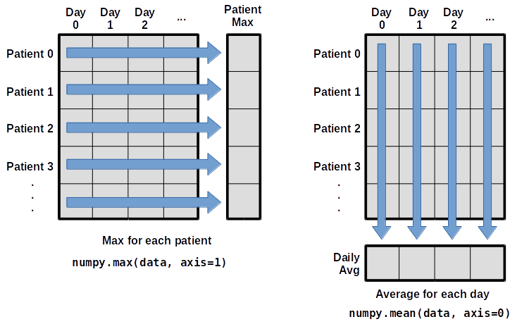
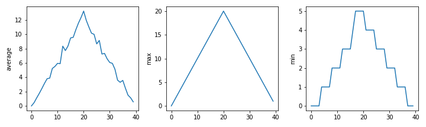

---
layout: two-cols
---

# Recap of Part 1

::left::

- Run Python in the REPL or as a `.py` script
- Values have **types**: `int`, `float`, `str`, `bool`
- Strings and lists are indexed **from zero**
- Use `for` loops, **accumulators** and `if`/`elif`/`else`
- Read tracebacks **from the bottom up**

<div class="pt-8">

Today: **functions**, **containers** and **data**

- Notes and exercises on train.rse: Intro to Python and Procedural Programming (Python)
- Example data: `uniqplus_python_data.zip` from the course

</div>

::right::

```python
masses = [3.54, 2.07, 9.22, 1.86, 1.71]

total = 0
for m in masses:
    if m > 3.0:
        total = total + m

print("Mass of the large ones:", total)
```

```text
Mass of the large ones: 12.76
```

---
layout: section
title: " "
---

## Part 1: Functions

---
layout: two-cols
---

# Writing functions

::left::

- Put a task in a function so you can reuse it
  - Smaller sections of code are easier to read and test
- Use `def name(parameters):` followed by an indented body
- Defining a function **does not run it**
- Match arguments to parameters by position or name
- `return` sends a result back to the caller
  - Reaching the end without `return` gives `None`

::right::

```python
def print_date(year, month, day):
    joined = f"{year}/{month}/{day}"
    print(joined)

print_date(1871, 3, 19)
print_date(month=3, day=19, year=1871)
```

```text
1871/3/19
1871/3/19
```

```python
def average(values):
    if len(values) == 0:
        return None
    return sum(values) / len(values)

a = average([1, 3, 4])
print("average of actual values:", a)
```

```text
average of actual values: 2.6666666666666665
```

---
layout: two-cols
---

# Default values and composition

::left::

- Parameters can have **default values**
  - Used when the caller omits an argument
- Put positional arguments **before** keyword arguments
- Functions can call other functions: **composition**
  - Reuse one function as part of another
- Keep shared logic in **one place**
  - Fixes then apply everywhere the function is called

::right::

```python
def say_hello(greeting="Hello", name="World"):
    return greeting + ", " + name + "!"

print(say_hello())
print(say_hello("Hi"))
print(say_hello(name="Jack"))
```

```text
Hello, World!
Hi, World!
Hello, Jack!
```

```python
def fahr_to_cels(fahr):
    return (fahr - 32) * (5 / 9)

def fahr_to_kelv(fahr):
    return fahr_to_cels(fahr) + 273.15

print(fahr_to_kelv(212))
```

```text
373.15
```

---
layout: two-cols
---

# Variable scope

::left::

- **Scope** determines where a name can be used
- **Global** variables are defined at module level
  - Functions in that module can read them
- **Local** variables belong to a function call
  - Parameters are local too
  - They cannot be accessed directly from outside
- Different functions can use the same local names

<div class="pt-6">
<span class="font-semibold text-lg text-red-700">Prefer arguments to global variables for function inputs.</span>
</div>

::right::

```python
pressure = 103.9

def adjust(t):
    temperature = t * 1.43 / pressure
    return temperature

print("adjusted:", adjust(0.9))
print("temperature after call:", temperature)
```

```text
adjusted: 0.01238691049085659
Traceback (most recent call last):
  File "foo.py", line 8, in <module>
    print("temperature after call:", temperature)
NameError: name 'temperature' is not defined
```

---
layout: two-cols
---

# Raising and catching exceptions

::left::

- **Exceptions** interrupt the normal flow of a program
- Use `raise` when a function cannot complete its task
  - Explain the problem in the error message
- `try`/`except` **catches** an exception so you can handle it
  - Only catch the errors you expect
  - A bare `except:` can hide unexpected errors

<div class="pt-6">
<span class="font-semibold text-lg text-red-700">Catch specific exceptions that your code can handle.</span>
</div>

::right::

```python
def average(values):
    if len(values) == 0:
        raise ValueError("Can't average an empty list")
    return sum(values) / len(values)

average([])
```

```text
ValueError: Can't average an empty list
```

```python
try:
    data = open("results.csv").read()
except FileNotFoundError:
    print("No results yet, run the analysis first")
```

```text
No results yet, run the analysis first
```

---
layout: section
title: " "
---

## Part 2: More containers

---
layout: two-cols
---

# Tuples and dictionaries

::left::

- A **tuple** is like a list, but **immutable**
  - Round brackets: `("Apple", "Banana")`
  - Useful for related values, such as coordinates
- A **dictionary** maps **keys** to **values**
  - Look up a value by its key
  - Also called a "map" or "hash" in other languages
  - Keys must be **hashable**, e.g. strings or numbers
  - A tuple key must contain only hashable values
- `in` checks whether a key is in the dictionary

::right::

<div class="code-sm">

```python
>>> y = ("Apple", "Banana", "Cherry")
>>> y[1]
'Banana'
>>> y[0] = "Mango"
TypeError: 'tuple' object does not support item assignment

>>> me = {"name": "Joe", "age": 39,
...       "jobs": ["Programmer", "Teacher"]}
>>> me["jobs"]
['Programmer', 'Teacher']
>>> me["age"] = 40
>>> "name" in me
True
>>> "Joe" in me
False
>>> "Joe" in me.values()
True
```

</div>

---
layout: two-cols
---

# Copying lists

::left::

- `y = x` does **not** copy a list
  - It's a second name for the **same** list
  - Changes through either name affect the same list
- `x[:]`, `list(x)` and `x.copy()` make a **shallow copy**
  - The new list still shares any nested objects
- Passing a list to a function does not copy it
  - The function can change the original list
- Use `copy.deepcopy(x)` to copy nested lists too

<div class="pt-6">
<span class="font-semibold text-lg text-red-700">Assignment gives a list another name; copying creates a new list.</span>
</div>

::right::

<div class="code-sm">

```python
x = [1, 2, 3]
y = x
y[1] = 20
print(x, y)
```

```text
[1, 20, 3] [1, 20, 3]
```

```python
x = [1, 2, 3]
y = x[:]
y[1] = 20
print(x, y)
```

```text
[1, 2, 3] [1, 20, 3]
```

```python
def add_sample(samples):
    samples.append("new")

my_samples = ["a", "b"]
add_sample(my_samples)
print(my_samples)
```

```text
['a', 'b', 'new']
```

</div>

---
layout: section
title: " "
---

## Part 3: Libraries and data

---
layout: two-cols
---

# Libraries

::left::

- **Libraries** provide code you can reuse
- Import **modules** to use their functions and types
- The **standard library** comes with Python: `math`, `glob`, `os`, `csv`...
- Install additional packages from [PyPI](https://pypi.org/) with `pip`
- Established libraries save you implementing common tasks
  - Check their documentation and examples

::right::

```python
>>> import math
>>> math.pi
3.141592653589793
>>> math.cos(math.pi)
-1.0

>>> from math import cos, pi
>>> cos(pi)
-1.0

>>> import math as m
>>> m.cos(m.pi)
-1.0

>>> help(math)
```

<div class="mt-6 border border-stone-500 rounded p-2 text-stone-700">
<code>numpy as np</code>, <code>pandas as pd</code> and <code>matplotlib.pyplot as plt</code> are common import aliases.
</div>

---
layout: two-cols
---

# Loading and slicing with NumPy

::left::

- NumPy: **Num**erical **Py**thon
  - Arrays and operations for numerical data
- The course uses the Carpentries **inflammation** data
  - 60 patients (rows) × 40 days (columns)
- `np.loadtxt` reads numerical CSV data into an **array**
  - Every element has the **same type**
- Index with `[row, column]`, starting from zero
- Slice each dimension: `data[0:4, 0:10]`

::right::

```python
>>> import numpy as np
>>> data = np.loadtxt(
...     fname="inflammation-01.csv",
...     delimiter=",",
... )
>>> data.shape
(60, 40)
>>> data.dtype
dtype('float64')

>>> data[30, 20]
13.0
>>> data[0:4, 0:10]
array([[0., 0., 1., 3., 1., 2., 4., 7., 8., 3.],
       [0., 1., 2., 1., 2., 1., 3., 2., 2., 6.],
       [0., 1., 1., 3., 3., 2., 6., 2., 5., 9.],
       [0., 0., 2., 0., 4., 2., 2., 1., 6., 7.]])
```

---
layout: two-cols
---

# Working with whole arrays

::left::

- **Vectorised** arithmetic works elementwise
  - No Python loop needed
- `np.mean`, `np.max`, `np.min`, `np.std`...
- Summarise this data with `axis=`:
  - `axis=0`: one value per **day**
  - `axis=1`: one value per **patient**
- **Broadcasting** matches shapes from the right
  - Sizes must be equal, or one must be 1



::right::

```python
>>> np.arange(5) + 2
array([2, 3, 4, 5, 6])
>>> np.arange(5) * np.arange(5)
array([ 0,  1,  4,  9, 16])
>>> np.arange(5) * np.arange(6)
ValueError: operands could not be broadcast
together with shapes (5,) (6,)

>>> np.mean(data)
6.14875
>>> np.mean(data, axis=0).shape
(40,)
>>> np.max(data, axis=1).shape
(60,)

>>> # subtract each day's mean from every patient
>>> (data - np.mean(data, axis=0)).shape
(60, 40)
```

---
layout: two-cols
---

# Visualising with Matplotlib

::left::

- Matplotlib creates plots from your data
- `imshow` for heatmaps, `plot` for lines
- Subplots put several plots in one figure
- Plots can reveal patterns worth investigating
  - Here, the maximum rises and falls in straight lines
  - The minimum changes in steps

```python
import matplotlib.pyplot as plt
plt.imshow(data)
plt.show()
```

::right::

<div class="h-full flex flex-col justify-center gap-3">

</div>

---
layout: two-cols
---

# pandas DataFrames

::left::

- pandas works with **tabular** data
- A **DataFrame** is a 2D table with named columns
  - Columns can have different types
- `pd.read_csv` loads a CSV
  - `index_col` uses a column as row labels
- Inspect data with `.info()`, `.columns` and `.describe()`
- `.T` swaps rows and columns
- The course uses **Gapminder** GDP per capita data

::right::

```python
>>> import pandas as pd
>>> data = pd.read_csv(
...     "data/gapminder_gdp_oceania.csv",
...     index_col="country",
... )
>>> data.info()
<class 'pandas.core.frame.DataFrame'>
Index: 2 entries, Australia to New Zealand
Data columns (total 12 columns):
 #   Column          Non-Null Count  Dtype
---  ------          --------------  -----
 0   gdpPercap_1952  2 non-null      float64
 ...

>>> data.describe()
       gdpPercap_1952  gdpPercap_1957  ...
count        2.000000        2.000000  ...
mean     10298.085650    11598.522455  ...
...
```

---
layout: two-cols
---

# Selecting data

::left::

- `.iloc[row, col]`: select by **position**
- `.loc[row, col]`: select by **label**
- `:` on its own means all rows or all columns
- Slices with `.loc` **include** the end label
- Comparisons give a **Boolean mask**
  - A DataFrame mask keeps matching values; others become `NaN`

::right::

<div class="code-sm">

```python
>>> data = pd.read_csv(
...     "data/gapminder_gdp_europe.csv",
...     index_col="country",
... )

>>> data.iloc[0, 0]
1601.056136
>>> data.loc["Albania", "gdpPercap_1952"]
1601.056136

>>> data.loc["Italy":"Poland", "gdpPercap_1962":"gdpPercap_1972"]
             gdpPercap_1962  gdpPercap_1967  gdpPercap_1972
country
Italy           8243.582340    10022.401310    12269.273780
Montenegro      4649.593785     5907.850937     7778.414017
Netherlands    12790.849560    15363.251360    18794.745670
Norway         13450.401510    16361.876470    18965.055510
Poland          5338.752143     6557.152776     8006.506993

>>> data[data > 10000]   # NaN where False
```

</div>

---
layout: two-cols
---

# Group by: split-apply-combine

::left::

- Grouped analysis has three steps:
  1. **Split** the data into groups
  2. **Apply** a function to each group
  3. **Combine** the results
- Example from the course: a "wealth score"
  - The fraction of years above the European mean GDP per capita
  - Group by score, then sum each column within each group
- pandas applies the operation to each group

::right::

```python
>>> mask_higher = data > data.mean()
>>> wealth_score = (
...     mask_higher.aggregate("sum", axis=1)
...     / len(data.columns)
... )
>>> wealth_score
country
Albania                   0.000000
Austria                   1.000000
...
United Kingdom            1.000000
dtype: float64

>>> data.groupby(wealth_score).sum()
          gdpPercap_1952  gdpPercap_1957  ...
0.000000    36916.854200    46110.918793  ...
0.333333    16790.046878    20942.456800  ...
0.500000    11807.544405    14505.000150  ...
1.000000   104317.277560   127332.008735  ...
```

---
layout: two-cols
---

# Looping over data sets

::left::

- Apply the same analysis to several files
- `glob.glob` finds files that match a pattern
  - The same `*` and `?` wildcards as Bash
- Combine `glob` with a `for` loop to process a batch of files
- This works best when files are **named consistently**
- Use `pathlib` to build paths for your operating system

::right::

```python
import glob
import pandas as pd

print(glob.glob("data/*.csv"))
```

```text
['data/gapminder_all.csv', ...]
```

```python
for filename in glob.glob("data/gapminder_*.csv"):
    data = pd.read_csv(filename)
    print(filename, data["gdpPercap_1952"].min())
```

```text
data/gapminder_all.csv 298.8462121
data/gapminder_gdp_africa.csv 298.8462121
data/gapminder_gdp_americas.csv 1397.717137
data/gapminder_gdp_asia.csv 331.0
data/gapminder_gdp_europe.csv 973.5331948
data/gapminder_gdp_oceania.csv 10039.59564
```

---

# Further topics

Topics to explore after this course:

- Comprehensions: `[x**2 for x in range(10)]`
- Reading and writing files with `open` and `with`
- Virtual environments and installing packages: `venv`, `pip`, `uv`
- **Project: Snake** on train.rse: a day building the game with `pygame`
  - Introduces object-oriented programming
- Other courses in this series:
  - **Object-oriented** and **functional** programming
  - **Testing** and **packaging and dependency management**
- [docs.python.org/3/tutorial](https://docs.python.org/3/tutorial/)

---
layout: center
---

# Exercises on train.rse

<div style="text-align: center; font-size: 1.5em; line-height: 1.6; color: #9ca3af;">
Practise what you've covered<br />
with the <span v-mark.underline.orange="1">course exercises</span>
</div>

<br />

<div style="text-align: center;">
Try changing the examples and checking what happens.
</div>

<div style="text-align: right; font-size: 0.85em; color: #6b7280; margin-top: 3em;">
Adapted from <a href="https://swcarpentry.github.io/python-novice-inflammation/">"Programming with Python" by The Carpentries</a> (CC-BY-4.0)<br />
and the SABS R³ / UNIVERSE-HPC Procedural Programming material (CC-BY-4.0)
</div>
